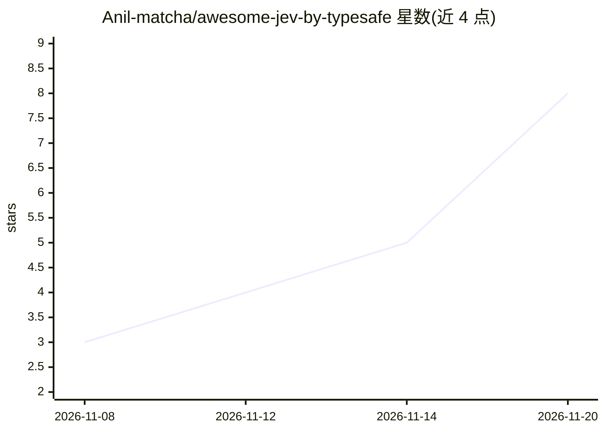

# Anil-matcha/awesome-jev-by-typesafe

⭐ 8 · Python · MIT · 推送 2026-10-13 · [GitHub](https://github.com/Anil-matcha/awesome-jev-by-typesafe) · [官网](https://typesafe.ai/) · 个人维护 · 中文 README

**面向开发者的 Jev 决策模型用例、模式与示例代码集合**

由社区维护的独立资料集，围绕 TypeSafe 的 System One 模型 Jev 汇编用例、提问模式、提示与 starter code。核心机制是三类原语：Choice（有限选项分类）、Score（有序量表打分）、Noul（语句为真的概率），返回带概率与置信度的类型化结果供代码分支；README 还给出快速事实表（端点、价格、限流、上下文长度）、官方接入路径、核心模式（fan-out、置信度门控路由等）与工作流控制类用例。声明非官方仓库，快照审校于 2026 年 9 月。

## 筛选速览

| 维度 | 判定 | 备注 |
|---|---|---|
| AI 角色 | `ai-knowledge` | 知识聚合/清单类 |
| 许可风险 | `permissive` | MIT |
| 部署形态 | `library` | 以包/库形式分发 |
| 模型依赖 | — | README 未给出锁定关系 |
| 硬件要求 | — | 无带数字的原话,不猜 |
| 安装摩擦 | `low` | 无编译、无系统依赖或容器化 |
| 成熟度 | — | 结构信号不足 |

## 能力要点

- Choice/Score/Noul 三类类型化判断原语，返回概率与置信度
- 六种核心模式：原子提问、speculative fan-out、置信度门控路由等
- 汇总官方接入路径：Python/JS SDK、Vercel AI Gateway、Cloudflare Workers AI
- 关联目录收录 9 个相关 awesome 清单与指南站点

## 适用场景

- 给支持工单系统加分类、紧急度与情绪打分的决策层
- 在确定性代码与 LLM 之间做置信度门控路由
- 检索 prompt injection 检测与自动化门控的写法示例

## 场景标签

`精选清单` `教程课程` · 领域:学习与行业

## 证据(README 行号)

> L11: An evidence-backed, practical collection of use cases, patterns, prompts, and starter code for **Jev**, TypeSafe AI
> L21: > This is an independent community collection. It is not an official TypeSafe AI repository. Product behavior, pric
> L39: - awesome-jev-prompts — 43 field-tested Jev question patterns (Choice/Score/Noul) with templates, thresholds, and f

## 星数曲线

2026-11-08 3 → 2026-11-20 8（+5）

---
*卡片 v1 · prompt 1.4 · 生成 2026-11-20 · 置信度 high · 依据 README sha `0f843d1412a3` · [字段定义](../../DATASET.md)*
