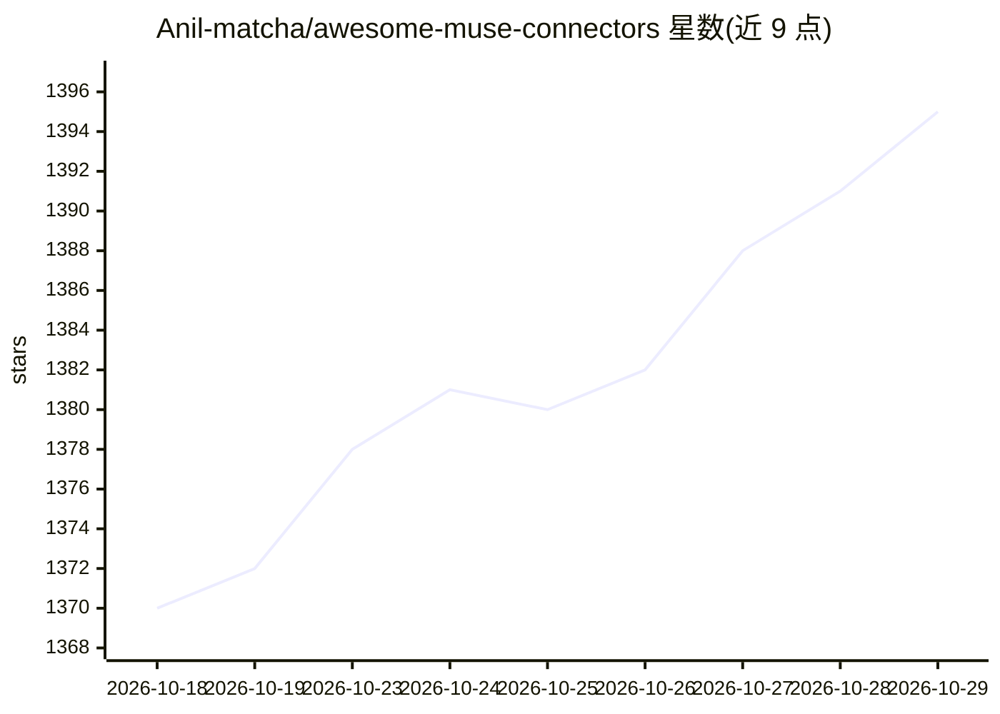

# Anil-matcha/awesome-muse-connectors

⭐ 1,395 · Python · MIT · 推送 2026-10-13 · [GitHub](https://github.com/Anil-matcha/awesome-muse-connectors) · [官网](https://ai.meta.com/muse/) · 个人维护

**Meta Muse 连接器与工作流模板策展清单**

社区维护的 Meta Muse 集成目录：从 MIT 许可项目复制收录 150 个连接器技能，逐条给出描述、认证说明、允许的主机与成熟度状态，并汇总 Meta 官方内置连接器；另含 12 个 agent 工作流模板（覆盖日程、研究、收件箱、差旅、发布管理等场景），每份模板定义目标、输入、输出格式、审批边界与停止条件，并提供六种工作流模式与复制即用的起始提示词。声明与 Meta 无隶属关系，提醒连接器可用性可能变化。

## 筛选速览

| 维度 | 判定 | 备注 |
|---|---|---|
| AI 角色 | `ai-knowledge` | 知识聚合/清单类 |
| 许可风险 | `permissive` | MIT |
| 部署形态 | `None` |  |
| 模型依赖 | — | README 未给出锁定关系 |
| 硬件要求 | — | 无带数字的原话,不猜 |
| 安装摩擦 | `low` | 无编译、无系统依赖或容器化 |
| 成熟度 | — | 结构信号不足 |

## 能力要点

- 150 个社区连接器技能，含认证说明、允许主机与成熟度标注
- 12 个工作流模板，每份含审批边界与可逆首跑测试
- 六种工作流模式（Watcher/Researcher/Drafter 等）与起始提示词
- 收录 Meta 官方内置连接器摘要及来源链接

## 适用场景

- 为 Meta Muse 查找和评估社区连接器技能
- 按模板搭建带审批边界的日程、收件箱、研究等 agent 工作流
- 学习编写可验证的 agent 提示词与工作流契约

## 场景标签

`精选清单` · 领域:学习与行业

## 证据(README 行号)

> L9: > A community-maintained catalog of integrations and connector skills for Meta Muse.
> L11: This repository includes Meta-named integrations and 150 community connector skills copied from an MIT-licensed pro
> L29: Browse 150 copied connector skills with descriptions, authentication notes, allowed hosts, operating rules, and mat

## 星数曲线

2026-10-18 1,370 → 2026-10-29 1,395（+25）

---
*卡片 v1 · prompt 1.4 · 生成 2026-10-21 · 置信度 high · 依据 README sha `6c83fe9b183b` · [字段定义](../../DATASET.md)*
