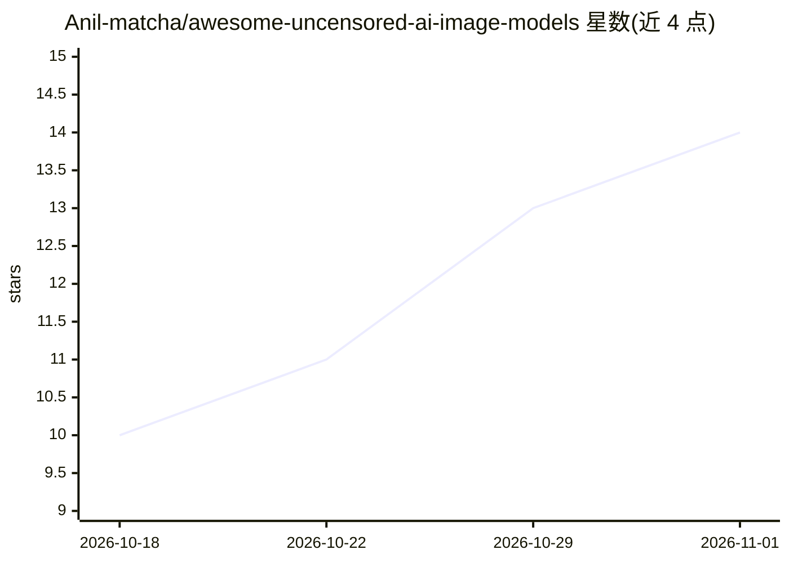

# Anil-matcha/awesome-uncensored-ai-image-models

⭐ 14 · NOASSERTION · 推送 2026-10-01 · [GitHub](https://github.com/Anil-matcha/awesome-uncensored-ai-image-models) · 个人维护

**社区维护的低过滤 AI 图像模型与端点编目清单**

一个社区维护的 AI 图像生成/编辑模型目录：按社区报告的无审查变体、待验证本地候选、被过滤的参考模型、社区微调版本等类别组织条目，覆盖 FLUX、Z-Image、Qwen Image、Wan、SDXL 等模型家族，记录访问方式（本地权重/托管/API）、许可证、过滤层级等信息。清单明确声明“uncensored”非标准化术语，并给出七级分类标签（verified/community-reported/to verify 等）区分验证程度；条目需文档化 checkpoint 版本、来源与许可条款。目录内容以 CC BY 4.0 授权，各模型仍受自身许可约束。

## 筛选速览

| 维度 | 判定 | 备注 |
|---|---|---|
| AI 角色 | `ai-knowledge` | 知识聚合/清单类 |
| 许可风险 | `none` | NOASSERTION |
| 部署形态 | `None` |  |
| 模型依赖 | — | README 未给出锁定关系 |
| 硬件要求 | — | 无带数字的原话,不猜 |
| 安装摩擦 | `low` | 无编译、无系统依赖或容器化 |
| 成熟度 | — | 结构信号不足 |

## 能力要点

- 收录社区报告的低过滤模型变体与开放权重候选，按访问方式与状态分类
- 七级分类标签区分维护者已验证、社区报告、待验证等不同证据强度
- 条目模板要求记录 checkpoint 版本、许可、VRAM、推理工具与过滤所在层级
- 明确声明不授予任何特定内容的创作/分发许可

## 适用场景

- 查找可本地运行的开放权重图像模型及其许可信息
- 比较不同图像模型在托管端点上的过滤策略差异
- 为图像模型选型核实版本、访问方式与许可证条款

## 场景标签

`图像生成` `精选清单` · 领域:内容生成

## 证据(README 行号)

> L3: > A community-maintained catalog of current AI image-generation and image-editing models—including local weights, ho
> L5: "Uncensored" is not a standardized technical term. A model's behavior can change with the checkpoint, prompt wrapper

## 星数曲线

2026-10-18 10 → 2026-11-01 14（+4）

---
*卡片 v1 · prompt 1.4 · 生成 2026-11-01 · 置信度 high · 依据 README sha `ed670fc54c15` · [字段定义](../../DATASET.md)*
