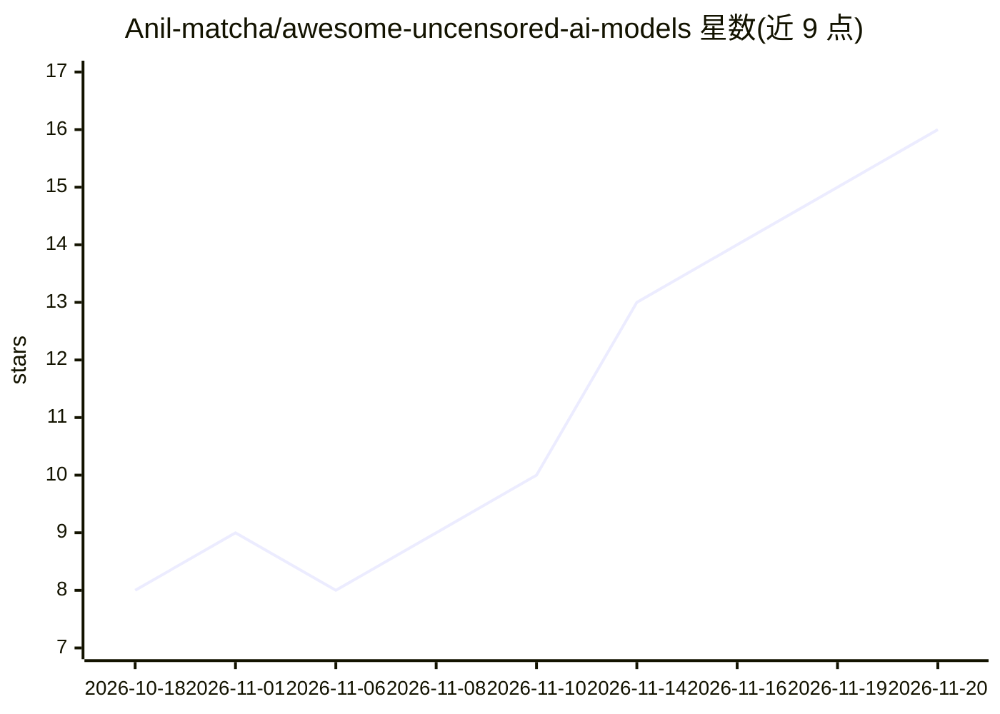

# Anil-matcha/awesome-uncensored-ai-models

⭐ 16 · NOASSERTION · 推送 2026-10-05 · [GitHub](https://github.com/Anil-matcha/awesome-uncensored-ai-models) · 个人维护

**低过滤/去审查化 AI 模型的溯源索引清单**

跨语言、图像、视频三种模态的低过滤与 abliterated 模型索引仓库，按用途指向五个配套的详细目录（LLM、编程、Agent、图像、视频）。清单记录每个候选的来源、访问路径（本地权重/托管端点）与验证日期，并区分模型家族、checkpoint、微调/适配器与托管端点等概念。README 声明本仓库为索引而非质量排名，条目未经独立测试，使用者需自行核对模型卡、许可证与行为证据。

## 筛选速览

| 维度 | 判定 | 备注 |
|---|---|---|
| AI 角色 | `ai-knowledge` | 知识聚合/清单类 |
| 许可风险 | `none` | NOASSERTION |
| 部署形态 | `None` |  |
| 模型依赖 | — | README 未给出锁定关系 |
| 硬件要求 | — | 无带数字的原话,不猜 |
| 安装摩擦 | `low` | 无编译、无系统依赖或容器化 |
| 成熟度 | — | 结构信号不足 |

## 能力要点

- 覆盖语言、图像、视频三种模态的候选模型清单
- 区分本地权重与托管端点等访问路径并记录来源
- 附模型/checkpoint/服务概念区分与使用前核查步骤
- 分设五个模态详细目录承接具体条目

## 适用场景

- 为文本、图像或视频生成任务查找低过滤模型候选
- 按访问路径（本地权重或托管 API）筛选模型
- 核查某个模型条目的来源、许可证与可用性

## 场景标签

`精选清单` `图像生成` `视频生成` · 领域:内容生成

## 证据(README 行号)

> L3: > A source-tracked guide to low-filter, abliterated, and community-reported AI models across language, image, and vi
> L83: This repository is an index across model types. Start with the task you want to do, then follow the relevant catalo
> L113: There is no cross-modality quality ranking in this index. A candidate being listed means it is documented in a com

## 星数曲线

2026-10-18 8 → 2026-11-20 16（+8）

---
*卡片 v1 · prompt 1.4 · 生成 2026-11-18 · 置信度 high · 依据 README sha `b359ece0c1eb` · [字段定义](../../DATASET.md)*
