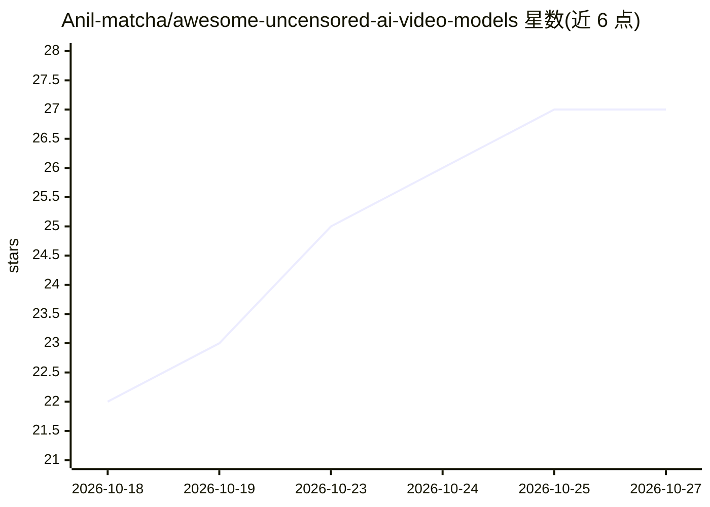

# Anil-matcha/awesome-uncensored-ai-video-models

⭐ 27 · NOASSERTION · 推送 2026-10-15 · [GitHub](https://github.com/Anil-matcha/awesome-uncensored-ai-video-models) · 个人维护

**社区维护的低过滤 AI 视频模型编目清单**

社区维护的 AI 视频生成/编辑模型目录，收录本地权重、适配器、托管端点与 API，按访问方式分为本地权重候选（Wan2.x、LTX-2、HunyuanVideo）、托管/API 系列、仅作参考的受过滤模型及社区报告变体。不把 uncensored 当作标准化术语，而是记录 checkpoint、推理管线、许可与过滤层级等细节，并用八级标签（Verified low-filter 至 Removed）标注证据质量。面向需要筛选与核验视频模型过滤行为的开发者/研究者。

## 筛选速览

| 维度 | 判定 | 备注 |
|---|---|---|
| AI 角色 | `ai-knowledge` | 知识聚合/清单类 |
| 许可风险 | `none` | NOASSERTION |
| 部署形态 | `None` |  |
| 模型依赖 | — | README 未给出锁定关系 |
| 硬件要求 | — | 无带数字的原话,不猜 |
| 安装摩擦 | `low` | 无编译、无系统依赖或容器化 |
| 成熟度 | — | 结构信号不足 |

## 能力要点

- 按本地权重/托管 API/受过滤参考/社区变体分类编目
- 八级证据标签区分验证、创作者标注与社区传闻
- 条目规范要求记录 checkpoint 版本、许可、VRAM 与过滤位置
- 文档内容以 CC BY 4.0 许可

## 适用场景

- 查找可本地运行的开放权重视频模型
- 比较各托管端点的过滤状态与访问方式
- 为视频模型选型核对许可与商业条款

## 场景标签

`精选清单` · 领域:学习与行业

## 证据(README 行号)

> L3: > A community-maintained catalog of current AI video-generation and video-editing models—including local weights, ad
> L5: “Uncensored” is not a standardized technical term. A video model’s behavior can change with the checkpoint, text enc
> L89: - **Verified low-filter** — the exact checkpoint and inference setup are documented, and a maintainer has reproduce

## 星数曲线

2026-10-18 22 → 2026-10-27 27（+5）

---
*卡片 v1 · prompt 1.4 · 生成 2026-10-26 · 置信度 high · 依据 README sha `fdc60321e0d6` · [字段定义](../../DATASET.md)*
