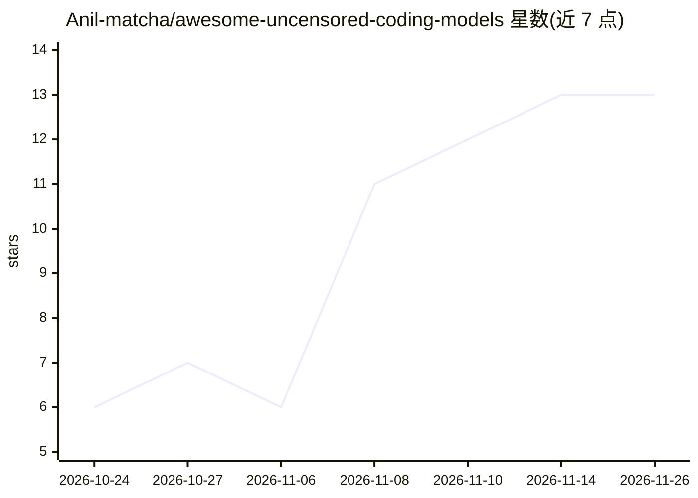

# Anil-matcha/awesome-uncensored-coding-models

⭐ 13 · Python · MIT · 推送 2026-11-24 · [GitHub](https://github.com/Anil-matcha/awesome-uncensored-coding-models) · [官网](https://muapi.ai/abliterated-llm-api) · 个人维护

**给开发者的低拒答编码模型目录与评测脚手架**

收录被社区标注为 uncensored/abliterated/derestricted/low-refusal 的编程语言模型目录，记录 Muapi 托管的确切模型 ID、工具调用/思维/视觉元数据及访问文档，并给出与 Codex CLI、Claude Code、OpenCode 的端点配置表。附带 tasks.jsonl 提示集与纯标准库 Python 评测 runner，用于按统一任务比较模型输出与拒答行为；仓库尚未发布任何模型评测结果。README 明确说明标签非标准化属性，需自行评估。

## 筛选速览

| 维度 | 判定 | 备注 |
|---|---|---|
| AI 角色 | `ai-knowledge` | 知识聚合/清单类 |
| 许可风险 | `permissive` | MIT |
| 部署形态 | `None` |  |
| 模型依赖 | — | README 未给出锁定关系 |
| 硬件要求 | — | 无带数字的原话,不猜 |
| 安装摩擦 | `low` | 无编译、无系统依赖或容器化 |
| 成熟度 | — | 结构信号不足 |

## 能力要点

- Muapi 托管的 9 个低拒答编码模型 ID 及能力元数据（工具调用/Thinking/Vision）
- 覆盖 bug 修复、测试、重构、SQL 等类别的 benchmark/tasks.jsonl 提示集与评测评分标准
- Codex CLI、Claude Code、OpenCode 三种编码代理的 Muapi 端点配置表
- 纯 Python 标准库 runner，按多次运行记录评分、原始输出与延迟

## 适用场景

- 在接入编码代理前，比较候选模型对同一任务的输出与拒答行为
- 按统一任务简报对多个托管端点做可复现的编码能力对比
- 为代理工作流筛选声明支持工具调用或视觉输入的模型

## 场景标签

`模型评测` · 领域:评测与运维

## 证据(README 行号)

> L5: A curated directory of language models people use or evaluate for programming, software maintenance, and coding-agen
> L121: This repository contains a small prompt set and a runner for comparing individual model responses. **No model resu
> L131: The runner requires Python 3.10+, a Muapi API key, and available credits. It uses only the Python standard library

## 星数曲线

2026-10-24 6 → 2026-11-26 13（+7）

---
*卡片 v1 · prompt 1.4 · 生成 2026-11-18 · 置信度 high · 依据 README sha `c68ddc44ad50` · [字段定义](../../DATASET.md)*
