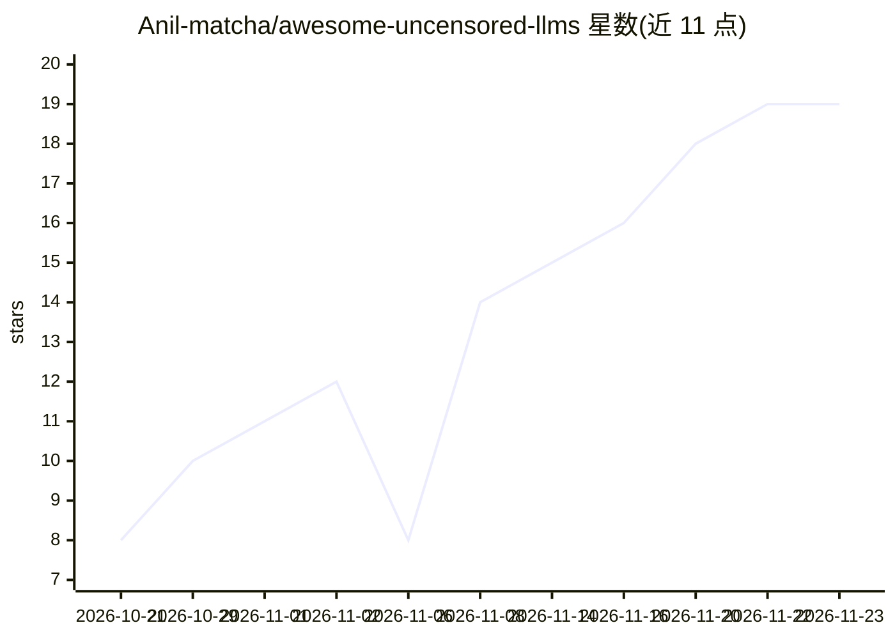

# Anil-matcha/awesome-uncensored-llms

⭐ 19 · NOASSERTION · 推送 2026-10-05 · [GitHub](https://github.com/Anil-matcha/awesome-uncensored-llms) · 个人维护

**低拒绝/去审查 LLM 的溯源编目清单：区分权重与托管服务**

一份以来源追溯为组织原则的模型目录：收录 abliterated、低拒绝及社区报告的开放权重与托管语言模型条目，用五级状态标签（Verified low-refusal / Community-reported / Hosted variant / Open-weight candidate / To verify）区分证据强度，并明确声明条目不构成排序或质量评分。清单区分模型权重与托管端点（如 Muapi 路由别名），附访问路径选择表与六步评估计划，提醒读者核对许可证、量化方式与推理模板后再使用。条目不提供安装命令，仅指向外部模型卡与 API 页面。

## 筛选速览

| 维度 | 判定 | 备注 |
|---|---|---|
| AI 角色 | `ai-knowledge` | 知识聚合/清单类 |
| 许可风险 | `none` | NOASSERTION |
| 部署形态 | `None` |  |
| 模型依赖 | — | README 未给出锁定关系 |
| 硬件要求 | — | 无带数字的原话,不猜 |
| 安装摩擦 | `low` | 无编译、无系统依赖或容器化 |
| 成熟度 | — | 结构信号不足 |

## 能力要点

- 五级状态标签区分低拒绝声明的证据强度
- 区分开放权重检查点与托管端点别名（含 Muapi slug）
- 按使用场景给出访问路径选择表与事前核对项
- 附可复现的小型评估计划（记录模型版本、设置、多采样）

## 适用场景

- 查找并核对 abliterated/低拒绝模型的权重来源与许可证
- 在托管端点与本地权重两种路径之间做选型比较
- 设计低拒绝模型的可复现评估流程

## 场景标签

`精选清单` · 领域:学习与行业

## 证据(README 行号)

> L3: > A source-tracked guide to open-weight, low-refusal, abliterated, and community-reported hosted language models. En
> L24: This is a shortlist for evaluation, not a benchmark ranking. The first group includes recent hosted model names and

## 星数曲线

2026-10-21 8 → 2026-11-23 19（+11）

---
*卡片 v1 · prompt 1.4 · 生成 2026-11-18 · 置信度 high · 依据 README sha `b71b6e2cd46c` · [字段定义](../../DATASET.md)*
