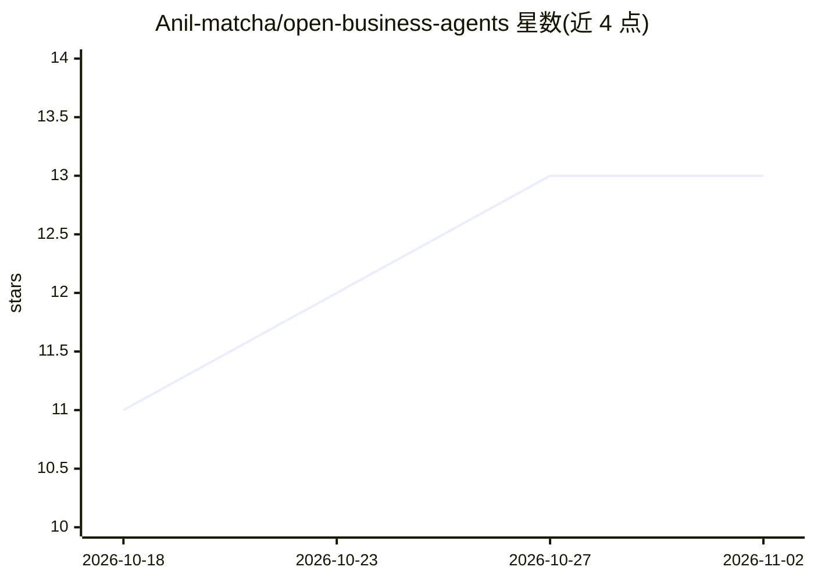

# Anil-matcha/open-business-agents

⭐ 13 · MIT · 推送 2026-09-29 · [GitHub](https://github.com/Anil-matcha/open-business-agents) · 个人维护

**面向商业任务的 AI agent 目录：按能力域组织的伞形仓库合集**

一个策划型 AI agent 目录，按 YouTube 增长、视频/图像/语音制作、SEO、社媒、广告、销售、电商等 17 个能力类别组织为伞形仓库，每个伞形仓库内含多个子 agent，以 SKILL.md 指令文件形式提供，可被任意 LLM 运行时或 MCP 客户端直接加载，无需应用代码。执行依赖 Muapi 统一 API（需自取 API key）。每个 agent 带 Coming Soon/Blueprint/Tested/Live 等成熟度标签，多数类别当前处于 Blueprint（有完整指令与流程但未经端到端验证）阶段。

## 筛选速览

| 维度 | 判定 | 备注 |
|---|---|---|
| AI 角色 | `ai-knowledge` | 知识聚合/清单类 |
| 许可风险 | `permissive` | MIT |
| 部署形态 | `None` |  |
| 模型依赖 | — | README 未给出锁定关系 |
| 硬件要求 | — | 无带数字的原话,不猜 |
| 安装摩擦 | `low` | 无编译、无系统依赖或容器化 |
| 成熟度 | `idea` | |

## 能力要点

- 17 个能力类别的伞形仓库组织结构，每仓库含多个子 agent
- agent 以 SKILL.md 指令文件交付，LLM 运行时/MCP 客户端可直接加载
- 五级成熟度标签（Coming Soon/Blueprint/Tested/Live/Open Source）
- 执行通过 Muapi 统一 API，需自取 API key

## 适用场景

- 企业或代理机构查找可复用的商业 AI agent
- 把 SKILL.md 加载到 Claude、Cursor 等 MCP 客户端执行业务任务
- 浏览各能力域 agent 的成熟度状态再决定是否采用

## 场景标签

`精选清单` · 领域:学习与行业

## 证据(README 行号)

> L7: Open Business Agents is a curated directory of AI agents, organized as broad, focused **umbrella repositories** (one
> L85: `SKILL.md` is a Markdown instruction file any LLM runtime — a hosted agent, an MCP client, a custom app — can load 

## 星数曲线

2026-10-18 11 → 2026-11-02 13（+2）

---
*卡片 v1 · prompt 1.4 · 生成 2026-10-31 · 置信度 high · 依据 README sha `ee8bfa41243b` · [字段定义](../../DATASET.md)*
