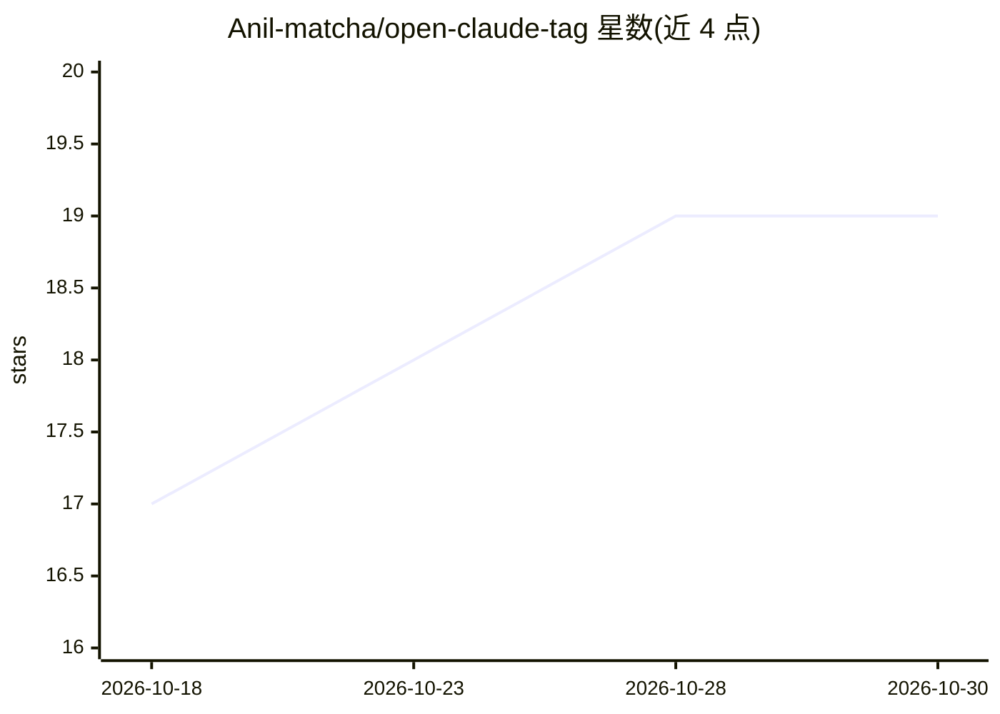

# Anil-matcha/open-claude-tag

⭐ 19 · Python · MIT · 推送 2026-08-17 · [GitHub](https://github.com/Anil-matcha/open-claude-tag) · 个人维护

**自托管 Slack 共享 AI 队友：每频道一个共享智能体**

开源、可自托管的 Slack AI 队友应用，定位为 Claude Tag 的替代：以 (workspace, channel) 而非 user 为会话键，实现每频道一个由全团队共享的智能体。机制上通过 LiteLLM 支持 Anthropic/OpenAI/Gemini/Groq/本地 Ollama 并可按频道覆盖模型；代理自动维护 MEMORY.md 记忆、5+ 工具调用后自动写 SKILL.md、heartbeat cron 主动巡检；每频道以 Markdown+TOML 目录配置，支持接入任意 MCP 服务器。需自建 Slack App（Socket Mode）、Python 3.11+ 与 LLM API key。

## 筛选速览

| 维度 | 判定 | 备注 |
|---|---|---|
| AI 角色 | `ai-native` | 本体是模型或模型工具 |
| 许可风险 | `permissive` | MIT |
| 部署形态 | `library` | 以包/库形式分发 |
| 模型依赖 | local-ok | 支持本地模型 |
| 硬件要求 | — | 无带数字的原话,不猜 |
| 安装摩擦 | `low` | 无编译、无系统依赖或容器化 |
| 成熟度 | — | 结构信号不足 |

## 能力要点

- 会话按 (workspace_id, channel_id) 键入，频道级共享上下文与多用户归属
- 经 LiteLLM 接入 Claude/GPT-4o/Gemini/Groq/Ollama，可按频道覆盖模型
- 代理自管 MEMORY.md 记忆与 SKILL.md 技能自动沉淀
- 文件式频道配置（CHANNEL.md/tools.toml），可接入任意 MCP 服务器

## 适用场景

- 在 Slack 频道里让团队共享一个 AI 队友处理协作任务
- 让智能体持续积累频道内的制度性知识与技能
- 自托管部署，Slack 数据不出自有基础设施

## 场景标签

`AI 助手` `Agent 记忆` · 领域:Agent 开发

## 证据(README 行号)

> L18: **Open Claude Tag** is a free, self-hostable AI teammate for Slack that works the way Claude Tag does — one shared 
> L46: - 🤖 **LLM-agnostic.** Use Claude, GPT-4o, Gemini, Groq, or local Ollama. Swap with one env var. Different channels 
> L229: |Anthropic Claude (default)|`claude-sonnet-4-6`|`ANTHROPIC_API_KEY`|

## 星数曲线

2026-10-18 17 → 2026-10-30 19（+2）

---
*卡片 v1 · prompt 1.4 · 生成 2026-10-29 · 置信度 high · 依据 README sha `b5b2cc466c20` · [字段定义](../../DATASET.md)*
