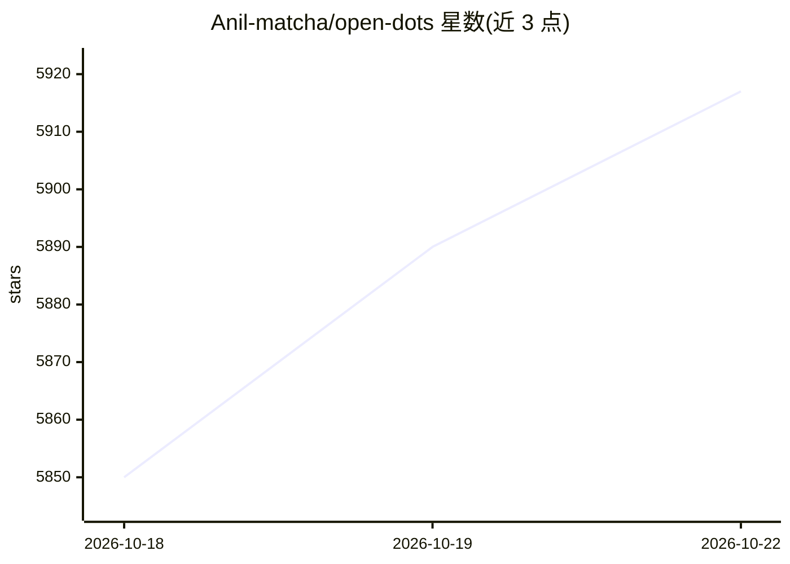

# Anil-matcha/open-dots

⭐ 5,917 · Python · 推送 2026-10-21 · [GitHub](https://github.com/Anil-matcha/open-dots) · 个人维护

**自托管的 AI 编码代理工作台，封装 Claude Code CLI**

面向个人与开发者的自托管代理工作区：通过 Telegram 与 Web UI 运行编码代理任务，当前封装 Claude Code CLI，仅在一次性沙箱中执行。提供 OAuth 连接 Claude 与可选 GitHub 绑定、危险操作（写文件/shell/Git push）的事前审批、定时重复任务与本地 Claude 桌面对话。数据存于 PostgreSQL（默认）或 SQLite（实验性）。限制：仅支持 Claude、无多代理功能，自称非上述付费产品的功能对等替代。

## 筛选速览

| 维度 | 判定 | 备注 |
|---|---|---|
| AI 角色 | `ai-native` | 本体是模型或模型工具 |
| 许可风险 | `none` | — |
| 部署形态 | `desktop` | 安装包/桌面程序 |
| 模型依赖 | locked-api |  |
| 硬件要求 | — | 无带数字的原话,不猜 |
| 安装摩擦 | `low` | 无编译、无系统依赖或容器化 |
| 成熟度 | `idea` | |

## 能力要点

- 从 Telegram 或浏览器在一次性沙箱中运行 Claude 编码任务
- 危险操作（文件写入/shell/Git push）需审批后才执行
- 定时重复任务：cron/工作日/间隔，含运行历史与错过跟踪
- 本地 claude CLI 对话线程与桌面应用（实验性）

## 适用场景

- 自己搭建并审批 AI 编码代理任务的运行环境
- 从 Telegram 定时触发并接收代理任务结果
- 在可见审批流程下让代理操作我的 GitHub 仓库

## 场景标签

`编码 Agent` `工作流自动化` · 领域:效率与自动化

## 证据(README 行号)

> L6: Today it wraps the Claude Code CLI: run tasks from Telegram or the web, review
> L24: - Run coding-agent tasks in disposable sandboxes from Telegram or a browser.
> L9: only, has named agents but no multi-agent features yet, and is not a

## 星数曲线

2026-10-18 5,850 → 2026-10-22 5,917（+67）

---
*卡片 v1 · prompt 1.4 · 生成 2026-10-20 · 置信度 mid · 依据 README sha `3997cdb0c9f6` · [字段定义](../../DATASET.md)*
