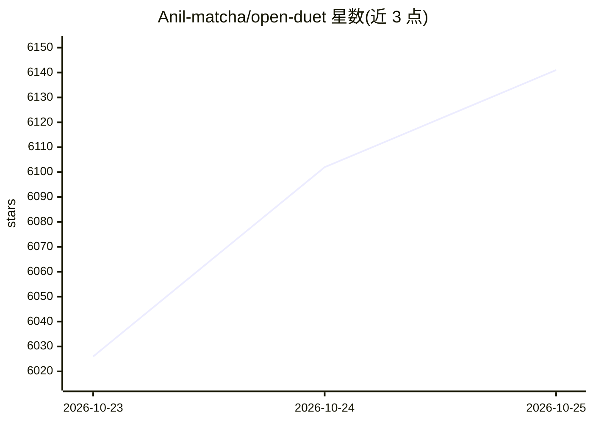

# Anil-matcha/open-duet

⭐ 6,170 · Python · Apache-2.0 · 推送 2026-10-25 · [GitHub](https://github.com/Anil-matcha/open-duet) · 个人维护

**自托管的 AI 同事工作台：带记忆、例程与审批的命名 agent**

面向个人和小团队的自托管 AI agent 工作区：创建具名 agent，各自拥有职责说明、记忆（MEMORY.md 与主题笔记）、独立工作区、定时例程（cron/webhook）与可选的 Docker 隔离容器；高风险操作须经人工 Allow/Deny 审批，决策留痕。引擎接入已登录的 Claude Code、Codex CLI、ACP CLI 或 OpenAI 兼容端点，支持用量受限时回退。可通过浏览器、桌面应用或 Telegram 使用，数据存于本地 PostgreSQL/SQLite。官方声明多项目（桌面应用、服务器模式）为 experimental，且非上述付费产品的功能对等替代。

## 筛选速览

| 维度 | 判定 | 备注 |
|---|---|---|
| AI 角色 | `ai-native` | 本体是模型或模型工具 |
| 许可风险 | `permissive` | Apache-2.0 |
| 部署形态 | `desktop` | 安装包/桌面程序 |
| 模型依赖 | — | README 未给出锁定关系 |
| 硬件要求 | — | 无带数字的原话,不猜 |
| 安装摩擦 | `low` | 无编译、无系统依赖或容器化 |
| 成熟度 | `idea` | |

## 能力要点

- 命名 agent：指令、记忆、工作区、审批模式，可导出导入
- cron/间隔/webhook 例程，含运行历史与漏跑追踪
- risky 操作人工审批：ask-first/accept-edits 模式、规则与决策日志
- 可选 Docker 隔离容器，agent 命令不落本机

## 适用场景

- 自建带记忆的 AI 研究员/客服分诊/报表助手并定期执行任务
- 在自己服务器上运行 agent，通过手机浏览器或 Telegram 使用
- 对 agent 的文件与命令操作保留逐条审批控制

## 场景标签

`AI 助手` `工作流自动化` · 领域:效率与自动化

## 证据(README 行号)

> L3: **Open Duet is an open-source, self-hosted workspace for AI coworkers: named
> L14: what Open Duet is. Agents run on an engine you already have signed in (Claude,
> L31: - **Approvals you control:** ask-first, accept-edits and plan modes, saved rules, a decision log and a safety floor

## 星数曲线

2026-10-23 6,026 → 2026-10-25 6,141（+115）

---
*卡片 v1 · prompt 1.4 · 生成 2026-10-23 · 置信度 high · 依据 README sha `d2b084114f25` · [字段定义](../../DATASET.md)*
