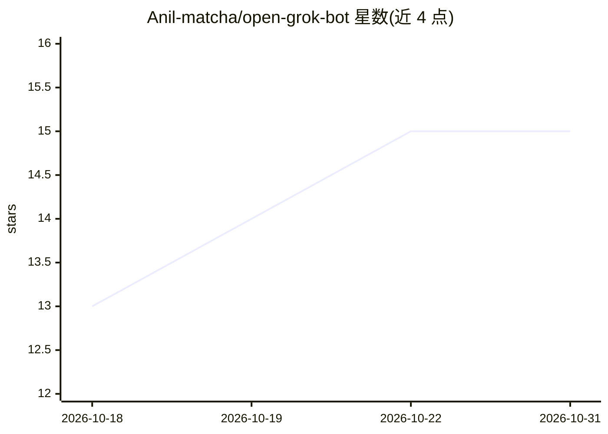

# Anil-matcha/open-grok-bot

⭐ 15 · Python · 推送 2026-09-20 · [GitHub](https://github.com/Anil-matcha/open-grok-bot) · 个人维护

**本地优先的 AI agent 工作区：bot 人设聊天+审批式工具与电脑操作**

由 Next.js 前端与 FastAPI 后端构成的本地 AI 工作区：创建带角色与系统提示的 bot 人设，通过 MUAPI 与模型对话（SSE 流式、图片附件、语音听写）。工具调用受治理：显式 workspace 命令、GitHub 连接器（Composio）与电脑操作均经拒绝默认的行动网关，需用户审批并产生审计事件。可选 Docker 隔离运行时（固定版本 Playwright 镜像，按 bot 分容器并施加资源限制）。数据存本地 SQLite。自述为原型，非多用户生产平台，且与 xAI 无关联。

## 筛选速览

| 维度 | 判定 | 备注 |
|---|---|---|
| AI 角色 | `ai-native` | 本体是模型或模型工具 |
| 许可风险 | `none` | — |
| 部署形态 | `self-host` | docker 或自建部署 |
| 模型依赖 | — | README 未给出锁定关系 |
| 硬件要求 | — | 无带数字的原话,不猜 |
| 安装摩擦 | `low` | 无编译、无系统依赖或容器化 |
| 成熟度 | `idea` | |

## 能力要点

- 拒绝默认的行动网关：workspace/GitHub/电脑操作均需用户审批并记录审计事件
- 可选 Docker 电脑运行时：每 bot 独立容器、只读根、CPU/内存/进程限制
- 通过 MUAPI 进行模型对话，SSE 流式输出、图片附件与浏览器语音听写
- Composio 连接器与 GitHub issue 只读/写入（审批门控）操作

## 适用场景

- 在本机搭建带 bot 人设的 AI 聊天工作区
- 让 agent 在审批约束下执行文件读写与 GitHub 操作
- 在隔离容器中运行浏览器/终端等电脑操作并事后审计

## 场景标签

`AI 助手` `GUI 自动化` · 领域:效率与自动化

## 证据(README 行号)

> L3: A local-first AI workspace for creating bot personas, chatting with models exposed through MUAPI, and keeping conver
> L24: - **SSE chat:** Send a message, persist it locally, and receive `turn.started`, `content.delta`, and `turn.complete
> L29: - **Governed action gateway:** Workspace actions use a structured request/result contract, a deny-by-default regist

## 星数曲线

2026-10-18 13 → 2026-10-31 15（+2）

---
*卡片 v1 · prompt 1.4 · 生成 2026-10-31 · 置信度 mid · 依据 README sha `ca18f71a060a` · [字段定义](../../DATASET.md)*
