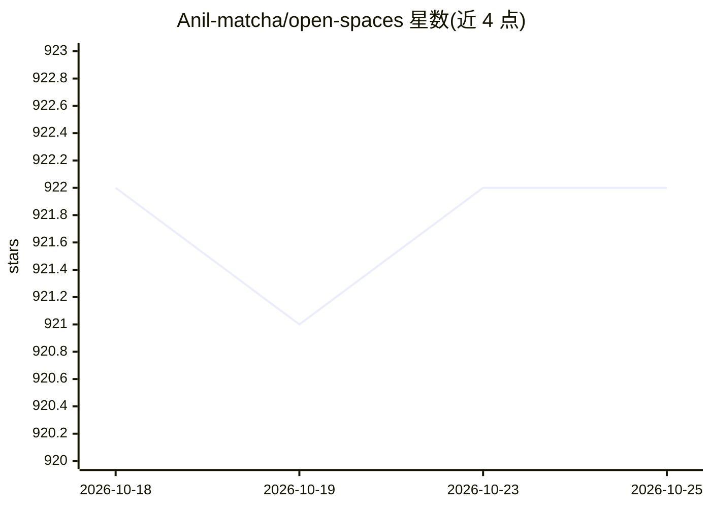

# Anil-matcha/open-spaces

⭐ 922 · JavaScript · MIT · 推送 2026-10-13 · [GitHub](https://github.com/Anil-matcha/open-spaces) · [官网](https://github.com/Anil-matcha/open-spaces) · 个人维护

**可自托管的共享 AI 工作区：共享页面、对话与 AI 工具**

面向自托管用户的 AI 工作区应用，将共享 Spaces、可编辑页面（TipTap 富文本/Markdown/斜杠命令/内联 AI 操作）、对话与 AI 工具整合于一个 Web 应用，通过配置的 MuAPI 集成提供聊天、图像生成与媒体上传。技术栈为 Next.js/React 前端加 FastAPI/SQLAlchemy 后端，数据库使用 PostgreSQL 兼容配置。README 明确标注项目处于活跃开发中：部分界面流为原型或模拟，认证与按 Space 授权尚未一致实施，不建议作为多用户服务暴露或处理敏感数据。

## 筛选速览

| 维度 | 判定 | 备注 |
|---|---|---|
| AI 角色 | `ai-native` | 本体是模型或模型工具 |
| 许可风险 | `permissive` | MIT |
| 部署形态 | `library` | 以包/库形式分发 |
| 模型依赖 | — | README 未给出锁定关系 |
| 硬件要求 | — | 无带数字的原话,不猜 |
| 安装摩擦 | `low` | 无编译、无系统依赖或容器化 |
| 成熟度 | `idea` | |

## 能力要点

- Spaces/页面/消息的创建与管理，TipTap 富文本编辑器含内联 AI 操作
- MuAPI 集成提供聊天、图像生成与媒体上传
- MIT 许可，支持自托管与代码修改
- Node.js + Python 3.10+ + PostgreSQL 本地运行，另有内存数据库开发回退

## 适用场景

- 在自有基础设施上搭建带 AI 对话与页面编辑的共享工作区
- 团队在页面内使用 AI 写作与图像生成工具
- 自托管且可检查、修改代码的 AI 协作空间

## 场景标签

`AI 助手` `图像生成` `知识库管理` · 领域:对话与助手

## 证据(README 行号)

> L3: **A free, open-source, self-hostable AI workspace for shared pages, conversations, and AI tools.**
> L13: - **AI in the workflow:** chat with configured models and use writing and image generation tools in the page editor
> L22: - Use the configured MuAPI integration for chat and image generation.

## 星数曲线

2026-10-18 922 → 2026-10-25 922（+0）

---
*卡片 v1 · prompt 1.4 · 生成 2026-10-21 · 置信度 mid · 依据 README sha `ec7cb62942eb` · [字段定义](../../DATASET.md)*
