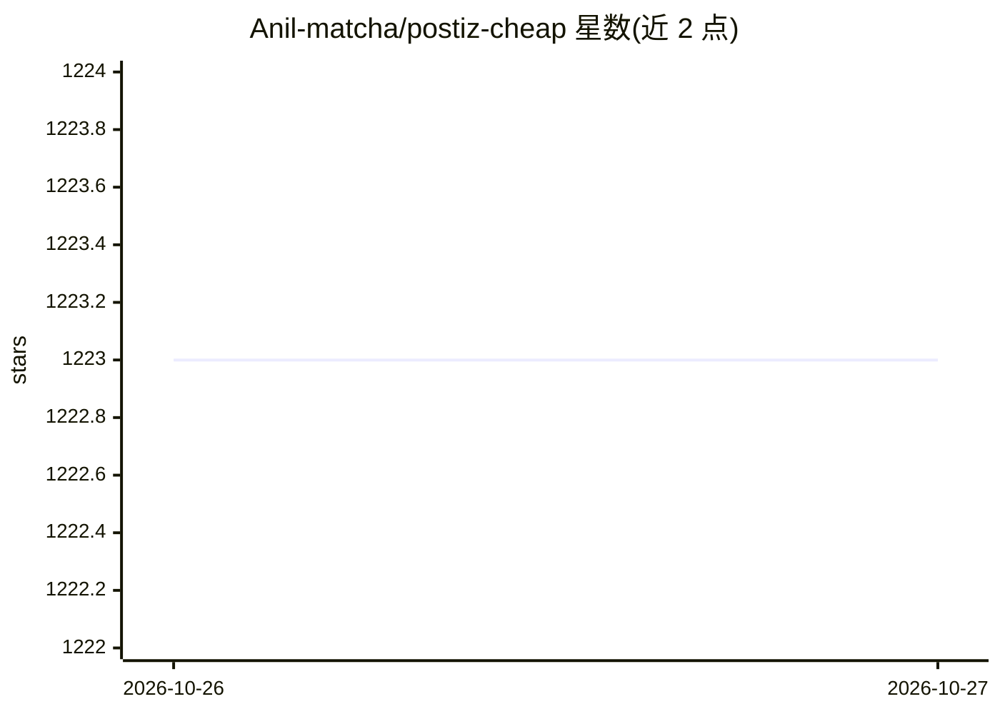

# Anil-matcha/postiz-cheap

⭐ — · [GitHub]() · 个人维护

**自托管社媒排程工具：日历、发布与 AI 撰稿一体化**

基于 Next.js 16 的自托管社交媒体排程应用：提供共享日历管理定时/已发布/失败帖文、多平台文案编辑器、发布前平台预览、账号连接与视频画廊，支持 YouTube/TikTok/Instagram/X/Facebook/LinkedIn/Threads/Pinterest 八个渠道。AI 部分为可选的标题/文案/标签生成与对话式营销助手，均通过 MuAPI 调用。数据存于 PostgreSQL，登录用 Google OAuth，含可选 Stripe 积分购买。注意：仓库不含后台定时器，到期帖文依赖前端路由触发；含不校验密码的演示登录，公开部署前需移除。

## 筛选速览

| 维度 | 判定 | 备注 |
|---|---|---|
| AI 角色 | `ai-enhanced` | 去掉 AI 部分产品仍成立 |
| 许可风险 | `permissive` | — |
| 部署形态 | `library` | 以包/库形式分发 |
| 模型依赖 | — | README 未给出锁定关系 |
| 硬件要求 | — | 无带数字的原话,不猜 |
| 安装摩擦 | `low` | 无编译、无系统依赖或容器化 |
| 成熟度 | — | 结构信号不足 |

## 能力要点

- 八渠道排程与平台特定文案选项、发布前预览
- AI 生成标题/文案/标签及对话式营销助手（经 MuAPI）
- 帖子状态、账号与已发布视频画廊统一管理
- MIT 许可，可自托管，外部服务费用另计

## 适用场景

- 在自己的服务器上统一管理多平台社媒发布日历
- 让 AI 起草平台文案再人工修改后发布
- 回顾已发布视频与失败帖文状态

## 场景标签

`AI 写作` · 领域:内容生成

## 证据(README 行号)

> L7:  A self-hostable social media scheduler for creators who want a shared calendar, a focused post composer, and contro
> L20: - **Draft with AI.** Generate a title, caption, and tags for a selected platform and tone, then review and edit the

## 星数曲线

2026-10-26 1,223 → 2026-10-27 1,223（+0）

---
*卡片 v1 · prompt 1.4 · 生成 2026-10-27 · 置信度 high · 依据 README sha `217ac813cede` · [字段定义](../../DATASET.md)*
