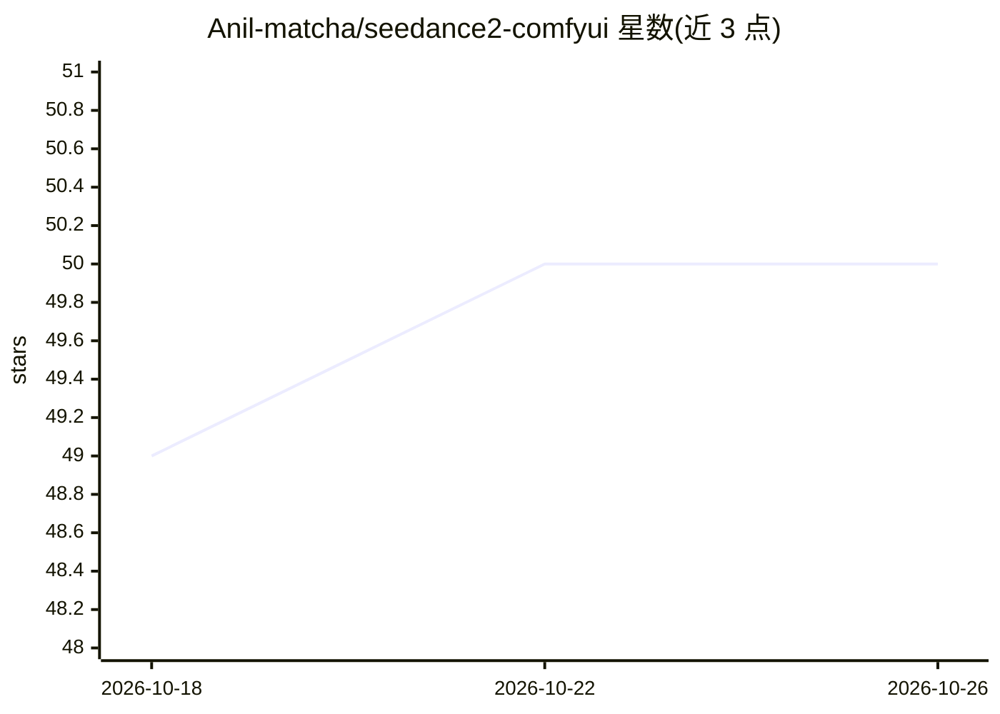

# Anil-matcha/seedance2-comfyui

⭐ 50 · Python · MIT · 推送 2026-09-28 · [GitHub](https://github.com/Anil-matcha/seedance2-comfyui) · [官网](https://muapi.ai/playground/seedance-2.0-mini-image-to-video) · 个人维护

**ComfyUI 自定义节点：经 MuAPI 调用字节 Seedance 生成视频**

面向 ComfyUI 用户的自定义节点包，通过 muapi.ai API 接入字节跳动 Seedance 2.0 与 2 Mini 视频生成模型，提供文生视频、图生视频（最多 9 张参考图）、Omni Reference 多模态参考（图/视频/音频）、一致角色表生成与角色视频、视频续延、保存下载等约 10 个节点，并附带可加载的示例工作流 JSON。生成任务经 muapi.ai 端点完成，需注册获取 API key；Seedance 2.5 的原生节点位于另一配套仓库。安装方式为 ComfyUI Manager 或手动 git clone。

## 筛选速览

| 维度 | 判定 | 备注 |
|---|---|---|
| AI 角色 | `ai-native` | 本体是模型或模型工具 |
| 许可风险 | `permissive` | MIT |
| 部署形态 | `library` | 以包/库形式分发 |
| 模型依赖 | — | README 未给出锁定关系 |
| 硬件要求 | — | 无带数字的原话,不猜 |
| 安装摩擦 | `low` | 无编译、无系统依赖或容器化 |
| 成熟度 | — | 结构信号不足 |

## 能力要点

- 文生视频/图生视频/Omni Reference/一致角色/视频续延等约 10 个节点
- 一致角色流程：1-3 张参考照生成 4K 角色表，可经 @character:<id> 或 sheet_image 保持身份
- 提供 2 个示例工作流 JSON 文件（T2V、一致角色）
- 经 muapi.ai API（x-api-key 认证）调用，无需本地模型

## 适用场景

- 在 ComfyUI 中用文本或参考图生成 Seedance 视频
- 用参考照片保持角色一致性并生成角色视频
- 批量快速迭代场景下使用 Seedance 2 Mini 生成视频

## 场景标签

`视频生成` · 领域:内容生成

## 证据(README 行号)

> L3: > **Seedance 2.5 ComfyUI and Seedance 2.0 custom nodes** — generate ByteDance Seedance videos directly inside ComfyU
> L45: - **Text-to-Video** — generate video from a text description

## 星数曲线

2026-10-18 49 → 2026-10-26 50（+1）

---
*卡片 v1 · prompt 1.4 · 生成 2026-10-24 · 置信度 mid · 依据 README sha `e81dc80bcf47` · [字段定义](../../DATASET.md)*
