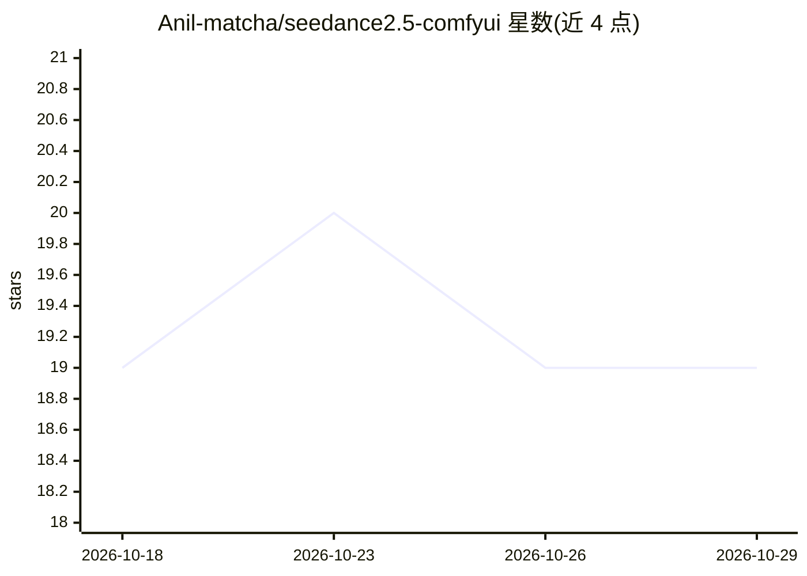

# Anil-matcha/seedance2.5-comfyui

⭐ 19 · Python · 推送 2026-10-15 · [GitHub](https://github.com/Anil-matcha/seedance2.5-comfyui) · 个人维护

**在 ComfyUI 中调用 Seedance 2.5 视频生成 API 的自定义节点包**

ComfyUI 自定义节点集合，通过 MuAPI 接入字节跳动 Seedance 2.5 视频生成服务：包含 API Key 节点、文生视频（720p/480p）、图生视频、首末帧插值、Omni Reference 多参考生成（20 图/6 视频/6 音频）、一致角色表、视频延展等 10 个节点。API Key 可经节点、环境变量或 MuAPI CLI 配置。安装方式为复制目录到 custom_nodes 并 pip 安装依赖，需 Python 3.8+ 及 ComfyUI 自带的 PyTorch 运行时；生成依赖云端 API，非本地模型。

## 筛选速览

| 维度 | 判定 | 备注 |
|---|---|---|
| AI 角色 | `ai-native` | 本体是模型或模型工具 |
| 许可风险 | `none` | — |
| 部署形态 | `library` | 以包/库形式分发 |
| 模型依赖 | — | README 未给出锁定关系 |
| 硬件要求 | — | 无带数字的原话,不猜 |
| 安装摩擦 | `low` | 无编译、无系统依赖或容器化 |
| 成熟度 | — | 结构信号不足 |

## 能力要点

- 10 个节点覆盖文生视频、图生视频、首末帧、Omni Reference、一致角色与视频延展
- Omni Reference 支持最多 20 图 + 6 视频 + 6 音频参考，prompt 内用 @image1/@video1/@audio1 引用
- 一致角色节点生成可复用角色表（sheet_image/character_id），供后续视频锚定
- API Key 支持节点输入、环境变量、CLI 与 ~/.muapi/config.json 四种配置方式

## 适用场景

- 在 ComfyUI 工作流中直接生成 Seedance 2.5 视频
- 用参考图和音频做多模态参考的角色一致性视频
- 对已有视频做延展或首末帧插值创作

## 场景标签

`视频生成` · 领域:内容生成

## 证据(README 行号)

> L3: ComfyUI custom nodes for the Seedance 2.5 API, delivered through MuAPI.
> L33: |Text-to-Video|Generates a 720p or 480p clip from a prompt.|

## 星数曲线

2026-10-18 19 → 2026-10-29 19（+0）

---
*卡片 v1 · prompt 1.4 · 生成 2026-10-29 · 置信度 high · 依据 README sha `3c573052f502` · [字段定义](../../DATASET.md)*
