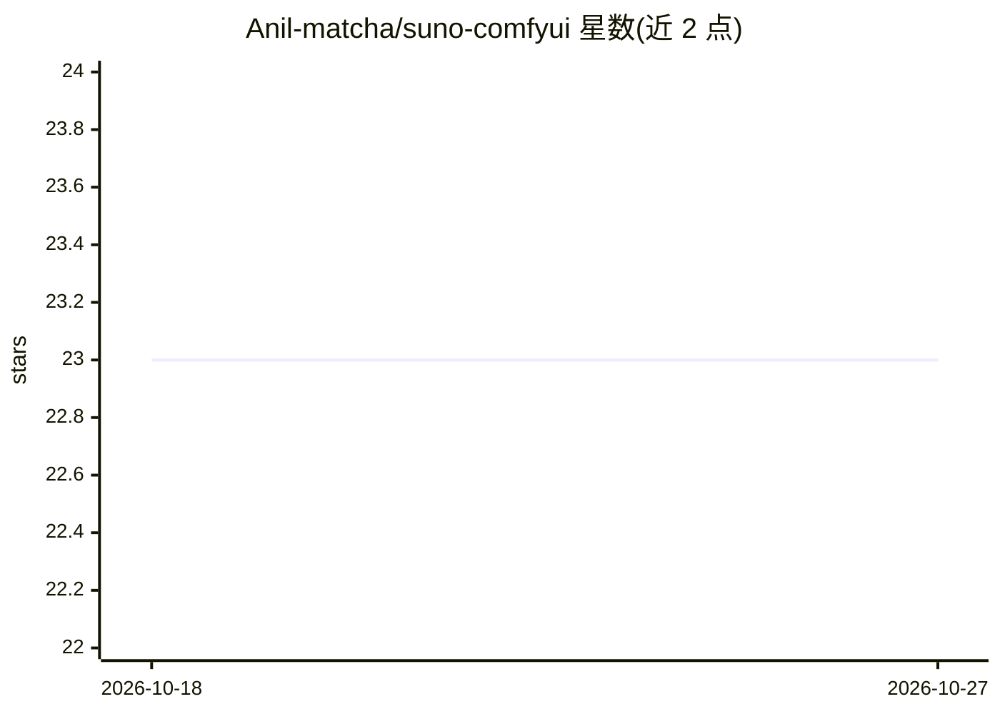

# Anil-matcha/suno-comfyui

⭐ 23 · Python · MIT · 推送 2026-08-19 · [GitHub](https://github.com/Anil-matcha/suno-comfyui) · [官网](https://muapi.ai) · 个人维护

**ComfyUI 的 Suno 音乐生成自定义节点包，经 muapi.ai API 调用**

一套 ComfyUI 自定义节点，封装 muapi.ai 的 Suno 音乐端点，供 ComfyUI 用户在工作流内生成、混音、续写和编辑 AI 音乐。提供 11 个节点，覆盖双曲风生成、Remix、Extend、加人声/伴奏、音效、歌词、风格扩展与最多 4 轨 Mashup，并可下载音频为 AUDIO tensor。需 muapi.ai API key（节点配置或 CLI 认证文件），通过 ComfyUI Manager 或 git clone 手动安装。

## 筛选速览

| 维度 | 判定 | 备注 |
|---|---|---|
| AI 角色 | `ai-ecosystem` | LLM/agent 周边工具 |
| 许可风险 | `permissive` | MIT |
| 部署形态 | `library` | 以包/库形式分发 |
| 模型依赖 | — | README 未给出锁定关系 |
| 硬件要求 | — | 无带数字的原话,不猜 |
| 安装摩擦 | `low` | 无编译、无系统依赖或容器化 |
| 成熟度 | — | 结构信号不足 |

## 能力要点

- 11 个节点覆盖生成/Remix/Extend/加人声/Mashup/歌词/音效等 Suno 能力
- 一次配置 API key 供所有节点使用（节点连线或 ~/.muapi/config.json）
- Save Audio 节点将生成结果下载为 ComfyUI AUDIO tensor 供下游音频节点使用
- 每次生成通常返回两个音频变体（audio_url_1 / audio_url_2）

## 适用场景

- 在 ComfyUI 工作流中从风格描述生成完整歌曲
- 对已有音轨做 Remix、续写或叠加 AI 人声
- 从主题生成歌词后接续生成带人声的歌曲
- 将最多 4 条音轨混合为 Mashup

## 场景标签

 · 领域:AI 音乐生成/创意工具

## 证据(README 行号)

> L3: > **ComfyUI custom nodes for Suno** — generate, remix, extend, and shape AI music directly inside ComfyUI using the 
> L182: This node pack uses the **muapi.ai** API under the hood:

## 星数曲线

2026-10-18 23 → 2026-10-27 23（+0）

---
*卡片 v1 · prompt 1.4 · 生成 2026-10-27 · 置信度 mid · 依据 README sha `8099b7843dc9` · [字段定义](../../DATASET.md)*
