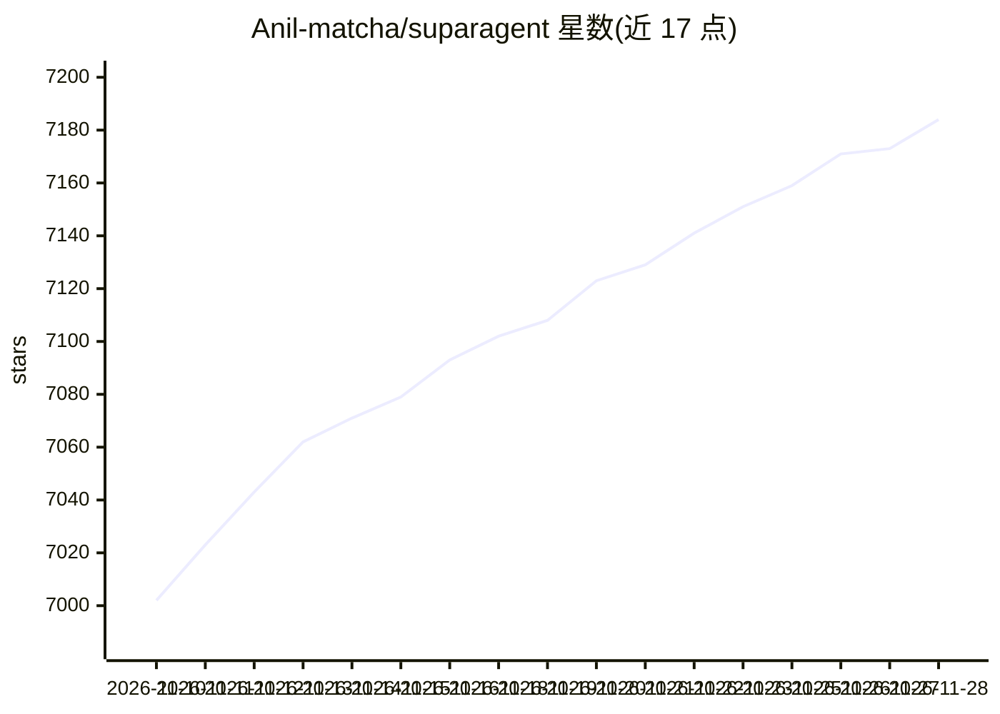

# Anil-matcha/suparagent

⭐ 7,184 · Python · Apache-2.0 · 推送 2026-11-27 · [GitHub](https://github.com/Anil-matcha/suparagent) · [官网](https://suparagent.ai) · 个人维护

**为个人和小团队提供可自托管的 AI 同事工作区**

一个开源工作区，用户可创建具名 agent，为其分配角色、工作区、记忆、例程与隔离沙箱，并在执行动作前要求人工批准。支持桌面应用与自托管服务器两种开源形态，托管服务为独立产品。不带模型，需自行接入引擎：Claude Code/Codex CLI、Gemini CLI、Cursor、ACP 命令行 agent、OpenRouter 或 OpenAI 兼容 API。含团队委派、计划任务、MCP 工具市场、手机端配对控制等。桌面安装包为实验性且未签名，自托管服务器为实验性。

## 筛选速览

| 维度 | 判定 | 备注 |
|---|---|---|
| AI 角色 | `ai-ecosystem` | LLM/agent 周边工具 |
| 许可风险 | `permissive` | Apache-2.0 |
| 部署形态 | `desktop` | 安装包/桌面程序 |
| 模型依赖 | local-ok | 支持本地模型 |
| 硬件要求 | — | 无带数字的原话,不猜 |
| 安装摩擦 | `low` | 无编译、无系统依赖或容器化 |
| 成熟度 | `idea` | |

## 能力要点

- 具名 agent：角色、记忆、例程与隔离沙箱，动作前可要求批准
- 支持 Claude Code、Codex、Gemini CLI、Cursor、OpenRouter、Ollama 等 7 类引擎
- 例程支持按计划、webhook 或手动运行，结果逐次审批
- 桌面应用、自托管服务器、手机 App 三端形态

## 适用场景

- 组建一个由主理 agent 委派专家 agent 完成研究、编辑等分工任务的团队
- 用例程把每周项目简报等重复工作定时执行并逐一审核
- 在自己服务器上保存 agent 记忆、会话与工作区文件

## 场景标签

`AI 助手` `多智能体` · 领域:Agent 开发

## 证据(README 行号)

> L10: Bring your own engine and provider account. Suparagent does not include a model
> L137: Connect an engine you already use: Claude Code or Codex CLI, Gemini CLI,

## 星数曲线

2026-11-10 7,002 → 2026-11-28 7,184（+182）

---
*卡片 v1 · prompt 1.4 · 生成 2026-11-28 · 置信度 high · 依据 README sha `fc0281500714` · [字段定义](../../DATASET.md)*
