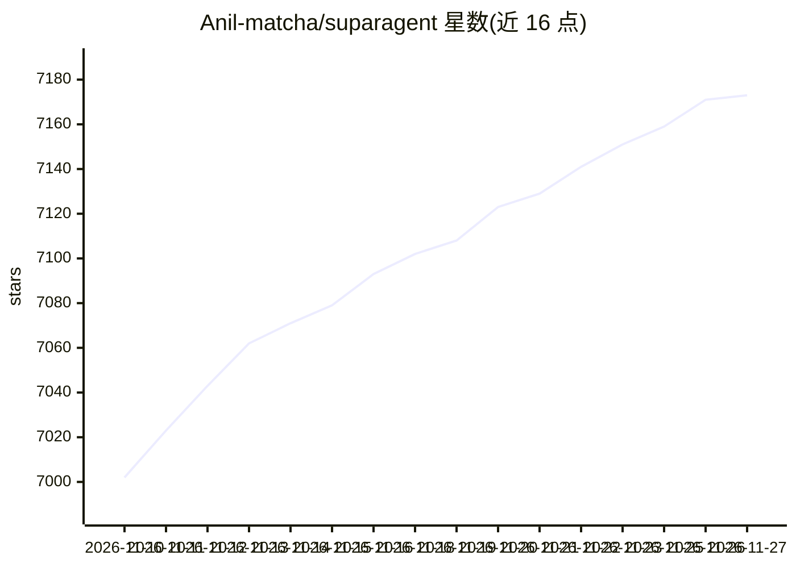

# Anil-matcha/suparagent

⭐ 7,173 · Python · Apache-2.0 · 推送 2026-11-26 · [GitHub](https://github.com/Anil-matcha/suparagent) · [官网](https://suparagent.ai) · 个人维护

**自托管 AI 同事工作区：命名代理、记忆、例程与审批**

为个人或小团队提供管理多个命名 AI 代理的工作区：每个代理拥有职责、记忆、例程和可选的隔离计算机，动作可设为需用户审批。代理可组成团队由 lead 分派任务，支持定时/webhook 例程、任务板、日历、手机端配对、MCP 工具与 Composio 应用连接。引擎由用户自备（Claude Code、Codex、Gemini CLI、Ollama 等），项目本身不含模型或订阅。桌面版从源码运行，安装器为实验性且未签名，自托管服务器为实验状态。

## 筛选速览

| 维度 | 判定 | 备注 |
|---|---|---|
| AI 角色 | `ai-native` | 本体是模型或模型工具 |
| 许可风险 | `permissive` | Apache-2.0 |
| 部署形态 | `desktop` | 安装包/桌面程序 |
| 模型依赖 | local-ok | 支持本地模型 |
| 硬件要求 | — | 无带数字的原话,不猜 |
| 安装摩擦 | `low` | 无编译、无系统依赖或容器化 |
| 成熟度 | `idea` | |

## 能力要点

- 命名代理具备指令、记忆、例程与审批机制
- lead 代理可将任务分派给专家代理协同完成
- 支持定时/webhook/manual 三种例程运行方式
- 引擎自选：CLI 代理、OpenRouter 或 OpenAI 兼容 API

## 适用场景

- 让多个 AI 代理分工完成每周项目简报等重复任务
- 在代理执行动作前逐一审批，控制凭证与应用访问
- 在自托管服务器上长期运行代理与例程

## 场景标签

`AI 助手` `GUI 自动化` `多智能体` · 领域:Agent 开发

## 证据(README 行号)

> L3: **A workspace for AI coworkers.**
> L137: Connect an engine you already use: Claude Code or Codex CLI, Gemini CLI,
> L150: When an agent answers, the selected engine receives the prompt and the context

## 星数曲线

2026-11-10 7,002 → 2026-11-27 7,173（+171）

---
*卡片 v1 · prompt 1.4 · 生成 2026-11-27 · 置信度 high · 依据 README sha `426886f271b8` · [字段定义](../../DATASET.md)*
