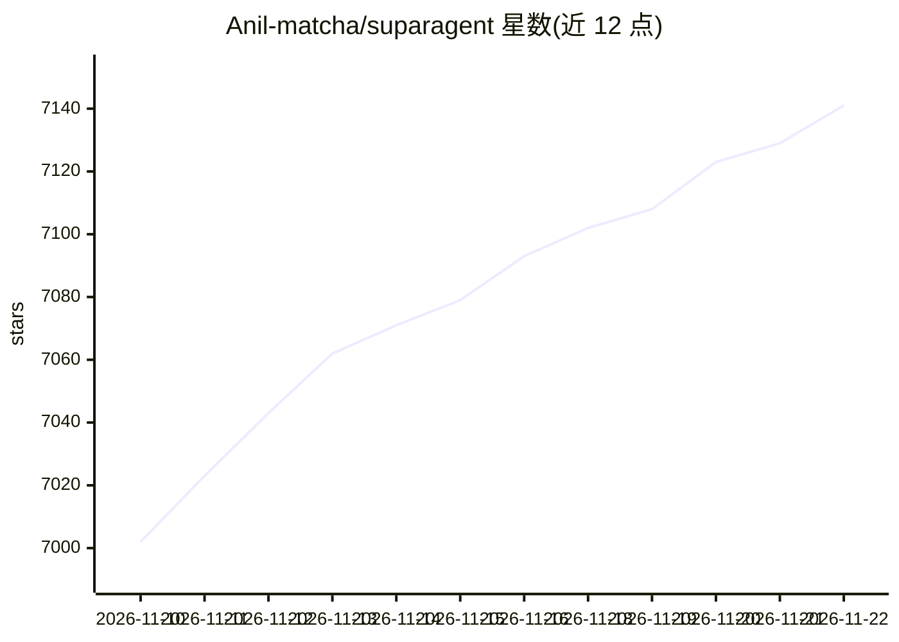

# Anil-matcha/suparagent

⭐ 7,141 · Python · Apache-2.0 · 推送 2026-11-19 · [GitHub](https://github.com/Anil-matcha/suparagent) · [官网](https://suparagent.ai) · 个人维护

**给个人/团队的 AI 同事工作区：创建、管理带记忆与例程的命名 agent**

自托管的 AI agent 工作区应用：创建命名的 agent 与团队，为其指定角色、引擎、工作区文件夹、记忆与审批模式；支持 lead agent 向专家 agent 分派任务、定时/webhook/手动例程、任务板与日历、通过 Composio 连接 GitHub/Gmail 等服务、MCP 市场与手机端配对。不内置模型，需自带引擎（Claude Code、Codex CLI、Gemini CLI、Cursor、ACP、OpenRouter 或 Ollama/LM Studio 等 OpenAI 兼容 API）。提供桌面端、自托管服务器与独立托管的付费服务；桌面安装包为实验性且未签名，自托管服务器为实验性。

## 筛选速览

| 维度 | 判定 | 备注 |
|---|---|---|
| AI 角色 | `ai-ecosystem` | LLM/agent 周边工具 |
| 许可风险 | `permissive` | Apache-2.0 |
| 部署形态 | `desktop` | 安装包/桌面程序 |
| 模型依赖 | local-ok | 支持本地模型 |
| 硬件要求 | — | 无带数字的原话,不猜 |
| 安装摩擦 | `low` | 无编译、无系统依赖或容器化 |
| 成熟度 | `idea` | |

## 能力要点

- 创建命名 agent/团队，lead 可向专家 agent 分派任务
- 审批模式控制 agent 行动（Ask first / Accept edits / Approve for me / Plan only）
- 例程支持定时、webhook 与手动运行，结果需人工审批
- 通过 Composio 连接 GitHub/Gmail/日历，MCP 市场添加工具

## 适用场景

- 组建 lead + 专家 agent 团队完成每周项目简报等重复工作
- 在自己电脑或自有服务器上托管带记忆和审批的 AI 同事
- 通过手机端审批 agent 的工具调用并管理对话

## 场景标签

`AI 助手` `多智能体` · 领域:Agent 开发

## 证据(README 行号)

> L10: Bring your own engine and provider account. Suparagent does not include a model
> L128: Connect an engine you already use: Claude Code or Codex CLI, Gemini CLI,

## 星数曲线

2026-11-10 7,002 → 2026-11-22 7,141（+139）

---
*卡片 v1 · prompt 1.4 · 生成 2026-11-17 · 置信度 high · 依据 README sha `254d17ac2877` · [字段定义](../../DATASET.md)*
