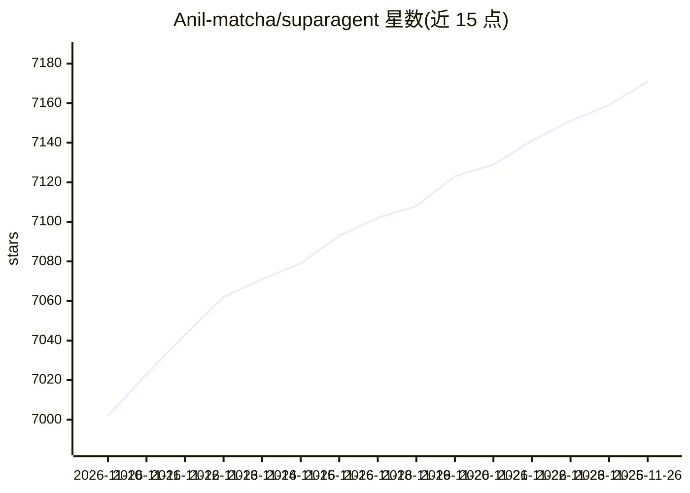

# Anil-matcha/suparagent

⭐ 7,171 · Python · Apache-2.0 · 推送 2026-11-25 · [GitHub](https://github.com/Anil-matcha/suparagent) · [官网](https://suparagent.ai) · 个人维护

**自托管 AI 同事工作区：命名 agent、记忆、例程与审批**

一个将多个命名 AI agent 组织在同一工作区中的应用：每个 agent 有职责、记忆、例程与审批设置，可由团队 lead agent 将任务委派给专家 agent，行动可设为 Ask first 等审批模式。支持桌面应用（Node.js 22+、uv、需自备引擎）与自托管服务器，托管服务为单独产品。引擎需用户自带（Claude Code、Codex CLI、Gemini CLI、Ollama、OpenRouter 等），不内置模型与订阅。处于活跃开发期，安装包未签名，更新路径未完整验证。

## 筛选速览

| 维度 | 判定 | 备注 |
|---|---|---|
| AI 角色 | `ai-native` | 本体是模型或模型工具 |
| 许可风险 | `permissive` | Apache-2.0 |
| 部署形态 | `desktop` | 安装包/桌面程序 |
| 模型依赖 | local-ok | 支持本地模型 |
| 硬件要求 | — | 无带数字的原话,不猜 |
| 安装摩擦 | `low` | 无编译、无系统依赖或容器化 |
| 成熟度 | `idea` | |

## 能力要点

- 命名 agent 与团队委派，lead 可用 Claude 或 Codex
- Ask first / Accept edits / Plan only 等审批模式控制 agent 自由度
- 例程支持定时、webhook、手动触发，且不会自行批准动作
- 通过 Composio key 连接 GitHub、Gmail、Google Calendar，接入 MCP Marketplace

## 适用场景

- 让多个 agent 分工完成研究报告与周报整理
- 对 agent 的文件修改与工具调用逐项审批
- 把可重复工作流设置为定时例程并逐次复核
- 在自有服务器上托管 agent 工作区数据

## 场景标签

`AI 助手` `工作流自动化` · 领域:效率与自动化

## 证据(README 行号)

> L3: **A workspace for AI coworkers.**
> L137: Connect an engine you already use: Claude Code or Codex CLI, Gemini CLI,
> L144: For desktop and self-hosted use, conversations, agent notes, routines, and

## 星数曲线

2026-11-10 7,002 → 2026-11-26 7,171（+169）

---
*卡片 v1 · prompt 1.4 · 生成 2026-11-22 · 置信度 high · 依据 README sha `5dd0f01f4c51` · [字段定义](../../DATASET.md)*
