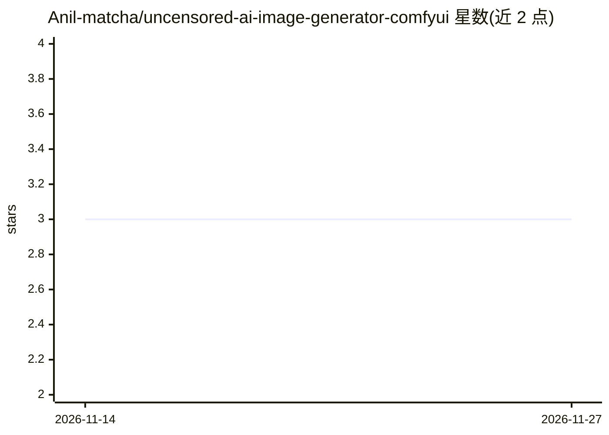

# Anil-matcha/uncensored-ai-image-generator-comfyui

⭐ 3 · MIT · 推送 2026-11-24 · [GitHub](https://github.com/Anil-matcha/uncensored-ai-image-generator-comfyui) · [官网](https://muapi.ai/ai-spicy-image-generator) · 组织维护

**无 GPU 本地跑无审查图像模型的 ComfyUI 接入指南**

一份英文使用指南：讲解在无显卡的笔记本上，通过 Muapi 节点包在 ComfyUI 中调用云端图像模型（Seedream、Qwen Image、Wan 2.7、Grok Imagine、Z-Image Turbo 等）。机制是 ComfyUI 本地运行、模型在 Muapi 服务器执行、生成图返回工作流；节点代码与示例工作流放在姊妹仓库 muapi-comfyui，本仓库仅含教程与端点字段表。生成按量计费，需网络与 Muapi API key；README 明确说明过滤程度因模型而异，且禁止生成真人的亲密/非自愿图像。

## 筛选速览

| 维度 | 判定 | 备注 |
|---|---|---|
| AI 角色 | `ai-native` | 本体是模型或模型工具 |
| 许可风险 | `permissive` | MIT |
| 部署形态 | `library` | 以包/库形式分发 |
| 模型依赖 | — | README 未给出锁定关系 |
| 硬件要求 | — | 无带数字的原话,不猜 |
| 安装摩擦 | `low` | 无编译、无系统依赖或容器化 |
| 成熟度 | — | 结构信号不足 |

## 能力要点

- 列出 7 个图像模型家族的端点名称与参数字段表
- 提供 Text-to-Image、Image-to-Image、Generic 通用节点三类用法
- 节点包与示例工作流由姊妹仓库 muapi-comfyui 提供
- 声明按量计费、无免费额度等使用限制

## 适用场景

- 在没有显卡的笔记本上通过 ComfyUI 生成图像
- 按端点字段表向不同图像模型发送生成或编辑请求
- 在 ComfyUI 中加载示例工作流做文生图与图生图

## 场景标签

`图像生成` `教程课程` · 领域:内容生成

## 证据(README 行号)

> L3: A plain-English guide to running unrestricted, low-filter AI image models inside ComfyUI on a laptop with no graphic
> L5: ComfyUI is a free app where you build AI workflows by connecting boxes (called nodes) with wires. Normally image mod

## 星数曲线

2026-11-14 3 → 2026-11-27 3（+0）

---
*卡片 v1 · prompt 1.4 · 生成 2026-11-26 · 置信度 high · 依据 README sha `55b1357172e5` · [字段定义](../../DATASET.md)*
