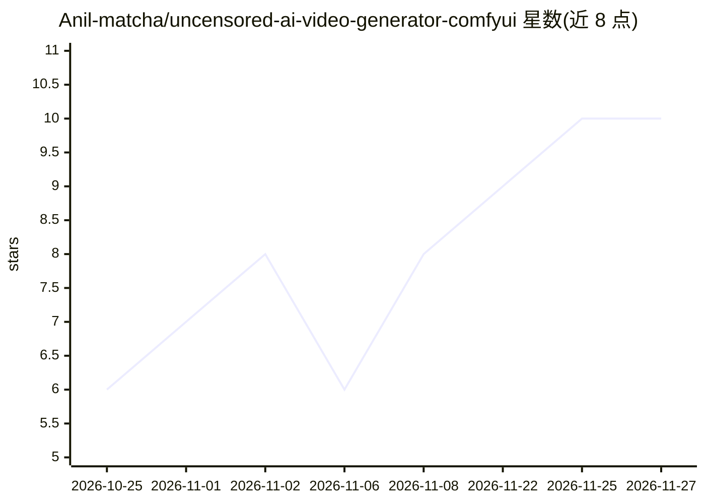

# Anil-matcha/uncensored-ai-video-generator-comfyui

⭐ 10 · MIT · 推送 2026-11-24 · [GitHub](https://github.com/Anil-matcha/uncensored-ai-video-generator-comfyui) · [官网](https://muapi.ai/ai-spicy-video-generator) · 组织维护

**在 ComfyUI 中无 GPU 运行低过滤视频模型的 Muapi 节点使用指南**

本仓库是一份图文指南，讲解如何在本地 ComfyUI 中通过 Muapi 节点调用服务器端视频模型生成视频：节点把请求发送到 Muapi 服务器运行模型，成品视频回传到本地输出目录，因此无需本地 GPU。正文包含节点包安装步骤、API key 配置、Seedance/Wan/MiniMax H3 等 spicy 端点及分辨率对照表、参数设置说明与付费计费等限制说明。节点代码存于另一个仓库 SamurAIGPT/muapi-comfyui，生成视频按 Muapi 用量计费。

## 筛选速览

| 维度 | 判定 | 备注 |
|---|---|---|
| AI 角色 | `ai-knowledge` | 知识聚合/清单类 |
| 许可风险 | `permissive` | MIT |
| 部署形态 | `library` | 以包/库形式分发 |
| 模型依赖 | — | README 未给出锁定关系 |
| 硬件要求 | — | 无带数字的原话,不猜 |
| 安装摩擦 | `low` | 无编译、无系统依赖或容器化 |
| 成熟度 | — | 结构信号不足 |

## 能力要点

- 本仓库为指南，节点与示例工作流在 muapi-comfyui 仓库
- 生成在服务器端运行，本地无 GPU 亦可使用
- 列出 Seedance/Wan/MiniMax H3 spicy 端点及分辨率对照表
- 未列入下拉菜单的模型可用 custom_endpoint 指定

## 适用场景

- 在无独立显卡的笔记本上通过 ComfyUI 生成视频
- 按指南接入 Muapi API key 并加载示例工作流
- 查找各 spicy 模型的端点名称与支持的分辨率

## 场景标签

`视频生成` · 领域:内容生成

## 证据(README 行号)

> L3: A plain-English guide to running unrestricted ("spicy") AI video models inside ComfyUI, on a laptop with no graphics
> L11: **All the nodes and example workflows live in one repo: SamurAIGPT/muapi-comfyui.** This repo is the guide, that re
> L55: - **It is pay as you go.** The node pack and these guides are free to download and use. Each video you generate is 

## 星数曲线

2026-10-25 6 → 2026-11-27 10（+4）

---
*卡片 v1 · prompt 1.4 · 生成 2026-11-20 · 置信度 high · 依据 README sha `935727733418` · [字段定义](../../DATASET.md)*
