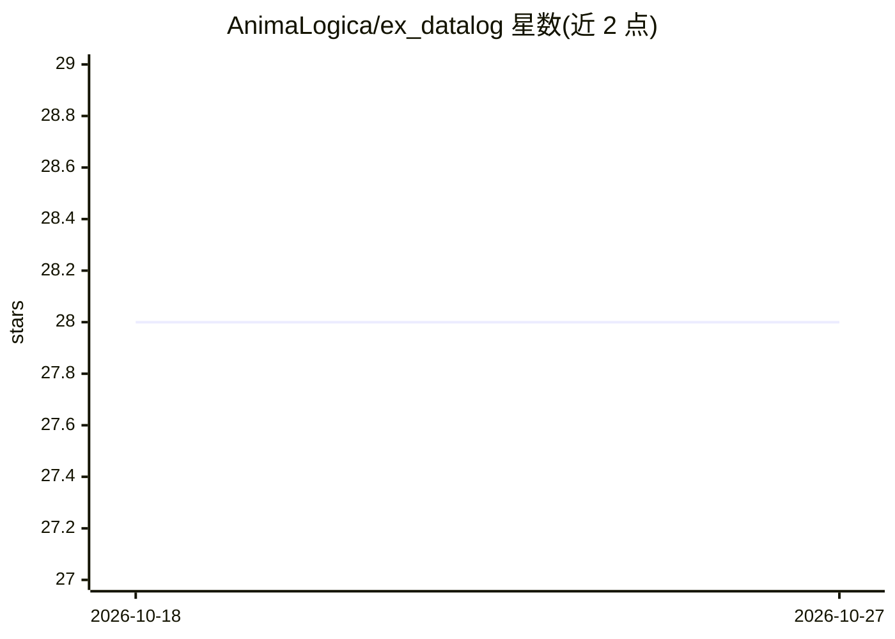

# AnimaLogica/ex_datalog

⭐ 28 · Elixir · MIT · 推送 2026-06-22 · [GitHub](https://github.com/AnimaLogica/ex_datalog) · 个人维护

**纯 Elixir 实现的 Datalog 规则推理引擎，供开发者构建声明式知识推理**

面向 Elixir/BEAM 开发者的 Datalog 引擎库：通过 Schema DSL 宏或 Builder API 声明关系、事实与规则，编译为引擎中立 IR 后由可插拔后端（默认 Storage.Map 堆内存储、Storage.ETS 表存储）以半朴素不动点方式求值。支持分层否定、递归规则、聚合（count/sum/min/max）、算术与比较约束、BEAM 回调谓词、实验性 magic sets 需求驱动求值、溯源（provenance）追踪与 :telemetry 事件；两种后端对同一程序保证确定且一致的输出。文档提到 Datalog 可作为 LLM 的知识层。以 Hex 包（~> 0.5.0）安装，871 个测试。

## 筛选速览

| 维度 | 判定 | 备注 |
|---|---|---|
| AI 角色 | `ai-ecosystem` | LLM/agent 周边工具 |
| 许可风险 | `permissive` | MIT |
| 部署形态 | `None` |  |
| 模型依赖 | — | README 未给出锁定关系 |
| 硬件要求 | — | 无带数字的原话,不猜 |
| 安装摩擦 | `low` | 无编译、无系统依赖或容器化 |
| 成熟度 | `idea` | |

## 能力要点

- 半朴素不动点求值与分层否定支持递归规则
- 可插拔存储后端：Map（<100K 事实）与 ETS（>100K 事实、并发读）
- provenance 溯源追踪（explain: true）与 :telemetry 生命周期事件
- 聚合、算术/比较/类型/字符串约束与 BEAM 回调谓词

## 适用场景

- 计算传递闭包、图遍历等递归查询
- 构建 RBAC、供应链分析、欺诈检测等基于规则的推导系统
- 为 LLM 应用提供可解释的派生知识层

## 场景标签

`知识图谱` · 领域:知识与检索

## 证据(README 行号)

> L17: and how Datalog can serve as a knowledge layer for LLMs.
> L32: It continues to influence modern databases, compilers, static analysis tools, knowledge graphs, authorization syste

## 星数曲线

2026-10-18 28 → 2026-10-27 28（+0）

---
*卡片 v1 · prompt 1.4 · 生成 2026-10-26 · 置信度 mid · 依据 README sha `5ac89352d876` · [字段定义](../../DATASET.md)*
