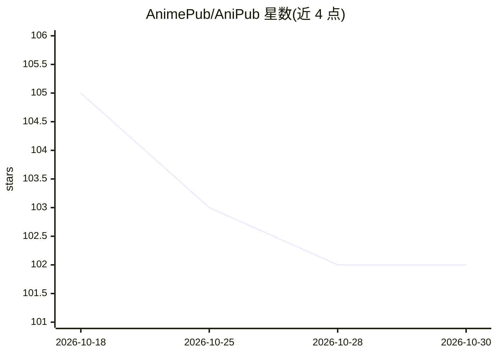

# AnimePub/AniPub

⭐ 102 · JavaScript · GPL-3.0 · 推送 2026-10-22 · [GitHub](https://github.com/AnimePub/AniPub) · [官网](https://anipub.org) · 组织维护

**面向动漫观众的开源无广告流媒体网站，含 AI 助手**

AniPub 是开源（GPL-3.0）的动漫流媒体网站：EJS/Node.js/Express/MongoDB 全栈 MVC 架构，提供无广告观看、搜索 8k+ 动漫、播放列表、书签、社区评论评分、JWT/Google OAuth 登录、用户实时聊天、MyAnimeList 集成（连接走 OAuth，未连接时经 Jikan API 展示详情）与 WhatsApp 更新推送。内置 AI 助手 Zero Two，以对话形式提供推荐、剧情与角色问答。本地安装需 Node.js v14+、MongoDB 与 Git，另有公开 API、npm 包、APK 移动端与 Linux 安装脚本。README 注明网页端广告拦截未达 100%。

## 筛选速览

| 维度 | 判定 | 备注 |
|---|---|---|
| AI 角色 | `ai-enhanced` | 去掉 AI 部分产品仍成立 |
| 许可风险 | `viral` | GPL-3.0 |
| 部署形态 | `library` | 以包/库形式分发 |
| 模型依赖 | — | README 未给出锁定关系 |
| 硬件要求 | — | 无带数字的原话,不猜 |
| 安装摩擦 | `low` | 无编译、无系统依赖或容器化 |
| 成熟度 | — | 结构信号不足 |

## 能力要点

- 无广告观看与搜索 8k+ 动漫目录
- AI 助手 Zero Two：对话式推荐与动漫问答
- MyAnimeList OAuth 同步，未连接时经 Jikan API 展示详情
- 公开免认证 API 与 npm 包、APK 移动端

## 适用场景

- 无广告地观看与追踪动漫进度
- 通过 AI 对话获取动漫推荐与剧情/角色信息
- 在社区评论、评分并与用户实时聊天
- 开发者调用公开 API 或 npm 包获取动漫数据

## 场景标签

`AI 助手` · 领域:对话与助手

## 证据(README 行号)

> L36: - **AniPub AI · Zero Two**: Your personal AI companion for recommendations, trivia, and chat-based interactions. As
> L88: - **AniPub AI**: An integrated module for conversational features.

## 星数曲线

2026-10-18 105 → 2026-10-30 102（-3）

---
*卡片 v1 · prompt 1.4 · 生成 2026-10-23 · 置信度 high · 依据 README sha `6fc3c816cb0b` · [字段定义](../../DATASET.md)*
