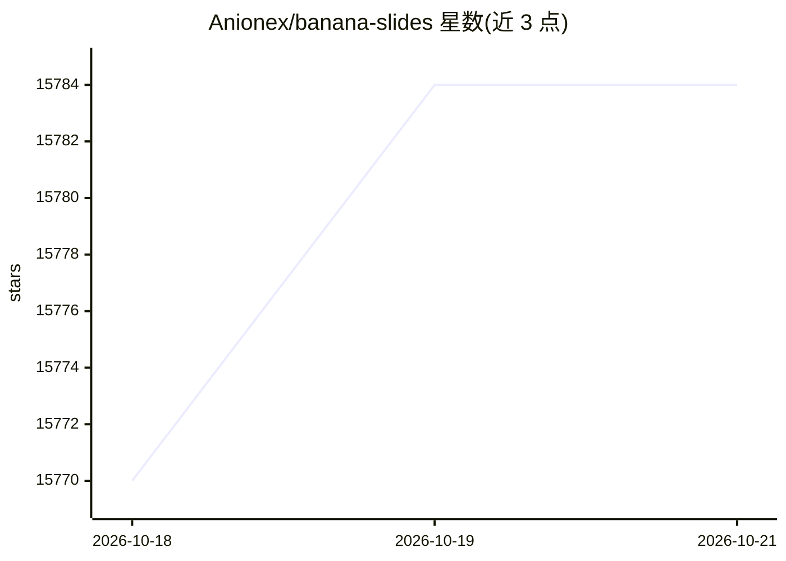

# Anionex/banana-slides

⭐ 15,833 · TypeScript · AGPL-3.0 · 推送 2026-10-22 · [GitHub](https://github.com/Anionex/banana-slides) · [官网](https://bananaslides.online) · 个人维护 · 中文 README

**基于图像生成模型的原生 AI PPT 生成应用，几分钟生成可编辑幻灯片**

面向普通用户、学生、教师与职场人士的 AI PPT 生成应用：以 nano banana pro / gpt-image 等图像生成模型为核心，支持一句话、大纲、页面描述三种起步方式生成幻灯片，可上传 PDF/Docx/MD/Txt 素材自动解析，并通过自然语言对指定区域做局部重绘或整页修改。支持导出 PPTX（含可编辑版 Beta）、PDF 及带 AI 语音旁白的讲解视频 MP4。部署方式包括 Docker Compose（含预构建镜像）、源码部署和桌面版安装包，需配置 Gemini 等 API 密钥；AGPL-3.0 开源，商业用途需另获授权。

## 筛选速览

| 维度 | 判定 | 备注 |
|---|---|---|
| AI 角色 | `ai-native` | 本体是模型或模型工具 |
| 许可风险 | `viral` | AGPL-3.0 |
| 部署形态 | `self-host` | docker 或自建部署 |
| 模型依赖 | — | README 未给出锁定关系 |
| 硬件要求 | — | 无带数字的原话,不猜 |
| 安装摩擦 | `low` | 无编译、无系统依赖或容器化 |
| 成熟度 | `idea` | |

## 动量与使用信号

- 维护:`active` — 距上次 push 1.1 天,年发版 9,18 位贡献者
- 涨星:近 1 天 **+6**(自 20261016 起算)
- 下载:GitHub Release 附件 累计 3,077(9 个 release)
- 平台:— · 协议:OPENAI-API

## 能力要点

- 一句话/大纲/页面描述三种路径生成 PPT，自然语言局部重绘与整页修改
- 上传任意模板图片与 PDF/Docx/MD/Txt 素材，AI 自动解析风格并逐页匹配
- 一键导出 PPTX（含可编辑版 Beta）、PDF 及带 AI 语音旁白的讲解视频 MP4
- Docker Compose 预构建镜像部署，另提供桌面版安装包与 CLI 操作

## 适用场景

- 明天要汇报，快速把想法变成一套演示文稿
- 把教学内容或上传的文档快速转成配图教案 PPT
- 用口头指令反复调整指定页面区域，无需手动排版
- 将幻灯片一键转成带旁白字幕的讲解视频

## 场景标签

`图像生成` `语音合成` · 领域:内容生成

## 证据(README 行号)

> L3:  基于图像生成模型的原生 AI PPT 应用，
> L96: 但是，nano banana🍌模型的出现让一切有了转机。我尝试使用🍌pro进行ppt页面生成，发现生成的结果无论是质量、美感还是一致性，都做的非常好，且几乎能精确渲染prompt要求的所有文字+遵循参考图的风格。那为什么不基于🍌p
> L158: - **一键将幻灯片转换为带 AI 语音旁白和字幕的讲解视频（MP4）**

## 星数曲线

2026-10-18 15,770 → 2026-10-21 15,784（+14）

---
*卡片 v1 · prompt 1.4 · 生成 2026-10-20 · 置信度 mid · 依据 README sha `a7b177ad22bd` · [字段定义](../../DATASET.md)*
