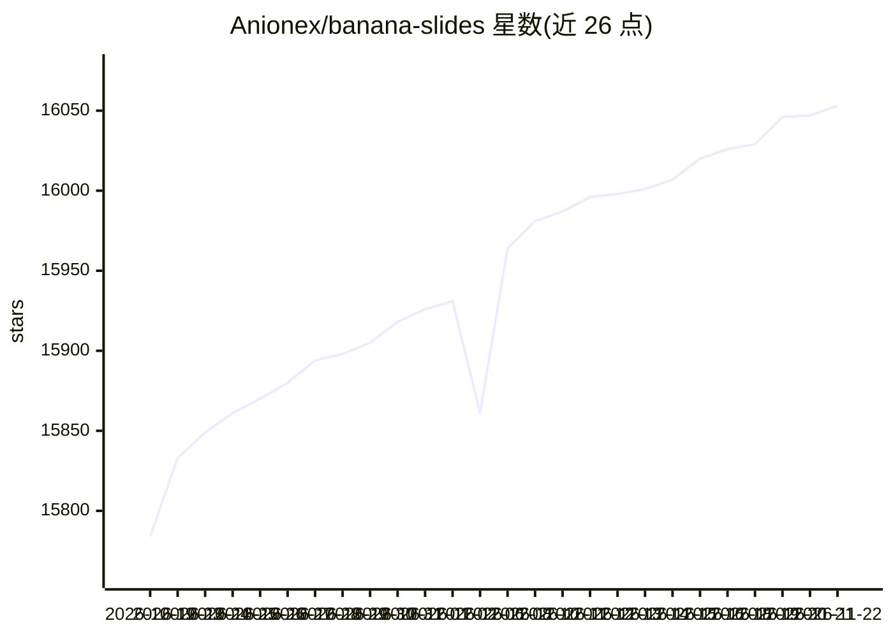

# Anionex/banana-slides

⭐ 16,053 · Python · AGPL-3.0 · 推送 2026-11-21 · [GitHub](https://github.com/Anionex/banana-slides) · [官网](https://bananaslides.online) · 个人维护 · 中文 README

**用图像生成模型生成/修改可编辑PPT的应用**

基于图像生成模型（nano banana / gpt-image 系列）的幻灯片生成应用：支持一句话、大纲或页面描述起步，自动生成大纲与逐页内容；可上传 PDF/Docx/MD 等素材自动解析入库，上传模板图片/PDF 由 AI 解析风格并逐页匹配；支持自然语言局部重绘与整页优化，导出 PPTX（含可编辑模式）、PDF 与带 AI 旁白字幕的讲解视频。提供 Web 端、Docker 部署、源码运行与桌面打包版。

## 筛选速览

| 维度 | 判定 | 备注 |
|---|---|---|
| AI 角色 | `ai-native` | 本体是模型或模型工具 |
| 许可风险 | `viral` | AGPL-3.0 |
| 部署形态 | `self-host` | docker 或自建部署 |
| 模型依赖 | — | README 未给出锁定关系 |
| 硬件要求 | — | 无带数字的原话,不猜 |
| 安装摩擦 | `low` | 无编译、无系统依赖或容器化 |
| 成熟度 | — | 结构信号不足 |

## 动量与使用信号

- 维护:`active` — 距上次 push 1.1 天,年发版 9,18 位贡献者
- 涨星:近 1 天 **+6**(自 20261016 起算)
- 下载:GitHub Release 附件 累计 3,077(9 个 release)
- 平台:— · 协议:OPENAI-API

## 能力要点

- 三种创作路径（想法/大纲/页面描述）与自然语言修改
- 上传模板图片/PDF，AI 解析风格并逐页智能匹配
- 导出可编辑 PPTX、PDF 及带 AI 语音旁白的 MP4 讲解视频
- 提供 Docker Compose、源码部署与桌面版（PyInstaller）

## 适用场景

- 零设计经验快速生成一套演示文稿
- 用自然语言对指定页面/区域做局部修改
- 把 PDF/Docx 教学或汇报素材转成配图 PPT
- 导出带旁白和字幕的讲解视频

## 场景标签

`图像生成` `视频生成` · 领域:内容生成

## 证据(README 行号)

> L3:  基于图像生成模型的原生 AI PPT 应用，
> L124: - **一句话生成**：输入一个主题，AI 自动生成结构清晰的大纲和逐页内容描述。
> L159: - **一键将幻灯片转换为带 AI 语音旁白和字幕的讲解视频（MP4）**

## 星数曲线

2026-10-19 15,784 → 2026-11-22 16,053（+269）

---
*卡片 v1 · prompt 1.4 · 生成 2026-11-22 · 置信度 mid · 依据 README sha `86d0e723ea10` · [字段定义](../../DATASET.md)*
