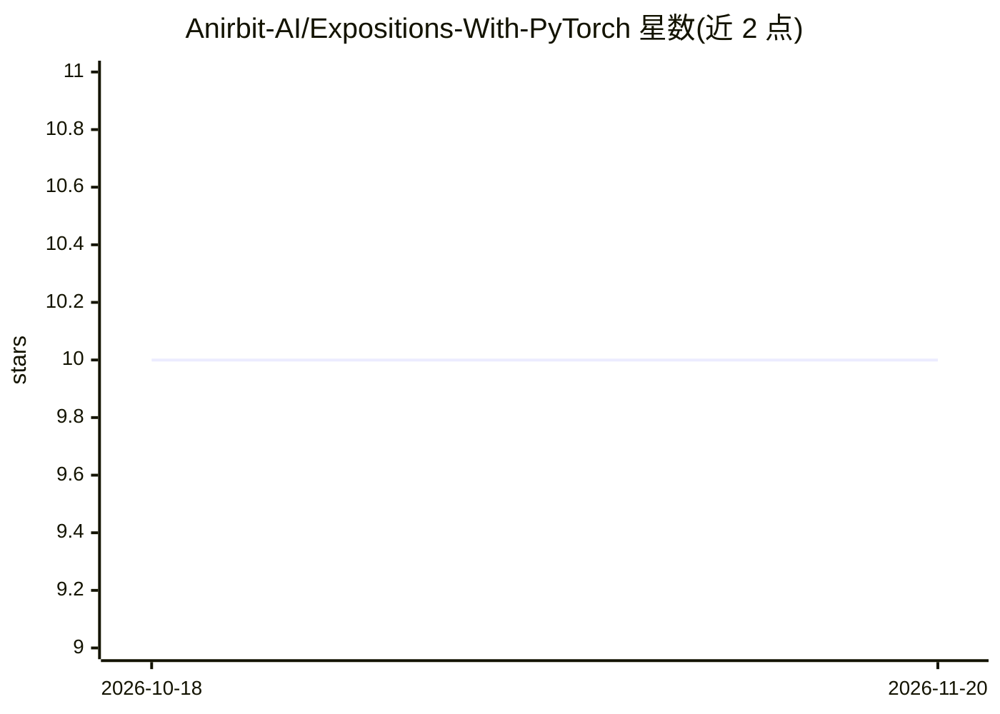

# Anirbit-AI/Expositions-With-PyTorch

⭐ 10 · Jupyter Notebook · MIT · 推送 2026-11-12 · [GitHub](https://github.com/Anirbit-AI/Expositions-With-PyTorch) · 个人维护

**面向理论研究者的 PyTorch 教学材料合集**

以 PyTorch 编写的教学性解说材料合集，目标读者是对理论感兴趣的研究者与学习者。仓库主题标签为 deep-learning 与 pytorch，README 仅含标题与一句话描述，未给出具体内容清单、安装步骤或运行方式，可见信息有限。

## 筛选速览

| 维度 | 判定 | 备注 |
|---|---|---|
| AI 角色 | `ai-knowledge` | 知识聚合/清单类 |
| 许可风险 | `permissive` | MIT |
| 部署形态 | `None` |  |
| 模型依赖 | — | README 未给出锁定关系 |
| 硬件要求 | — | 无带数字的原话,不猜 |
| 安装摩擦 | `low` | 无编译、无系统依赖或容器化 |
| 成熟度 | — | 结构信号不足 |

## 能力要点

- 面向理论读者的 PyTorch 教学材料
- 主题标签覆盖 deep-learning 与 pytorch

## 适用场景

- 学习用 PyTorch 表达理论概念
- 查找深度学习理论相关的教学材料

## 场景标签

`教程课程` · 领域:学习与行业

## 证据(README 行号)

> L2: Creating Theoretician Friendly Educational Material For PyTorch

## 星数曲线

2026-10-18 10 → 2026-11-20 10（+0）

---
*卡片 v1 · prompt 1.4 · 生成 2026-11-20 · 置信度 mid · 依据 README sha `0ff13cf6aa0c` · [字段定义](../../DATASET.md)*
