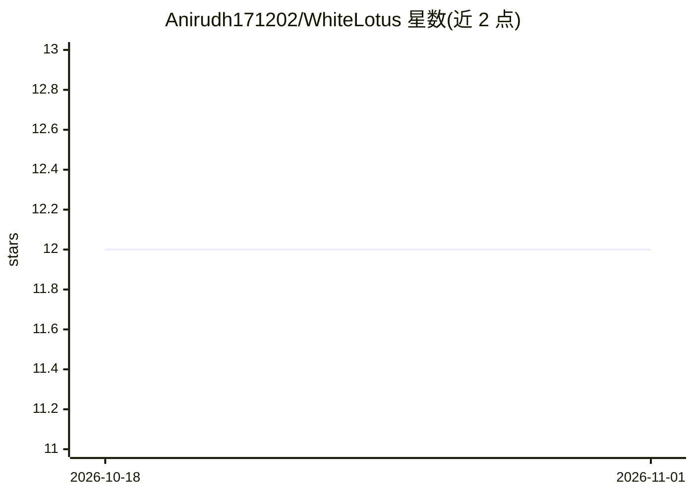

# Anirudh171202/WhiteLotus

⭐ 12 · C++ · MIT · 推送 2026-04-04 · [GitHub](https://github.com/Anirudh171202/WhiteLotus) · [官网](https://anirudhsathiya.com/blog/transformer) · 个人维护

**纯 C++ 手写 LLM 推理引擎：不依赖 PyTorch 与框架**

面向 CPU 的 LLM 推理引擎，tokenizer、GPT2 Transformer 注意力、KV cache、调度器与采样器均从零手写，定位为可通读代码以理解推理机制的教学型实现。C++ 核心与 Python API 通过 pybind11 分层，提供异步请求引擎（调度队列+工作线程，支持并发请求）、温度/top-K/top-P/重复惩罚采样，以及内存映射 safetensors 零拷贝权重加载。安装为 clone 后 pip install -e .，需自行下载模型（示例为 TinyStories-33M）并做权重转换。

## 筛选速览

| 维度 | 判定 | 备注 |
|---|---|---|
| AI 角色 | `ai-ecosystem` | LLM/agent 周边工具 |
| 许可风险 | `permissive` | MIT |
| 部署形态 | `library` | 以包/库形式分发 |
| 模型依赖 | — | README 未给出锁定关系 |
| 硬件要求 | — | 无带数字的原话,不猜 |
| 安装摩擦 | `low` | 无编译、无系统依赖或容器化 |
| 成熟度 | — | 结构信号不足 |

## 能力要点

- tokenizer/引擎/调度器/KV cache/采样器全组件手写，无 PyTorch 与框架依赖
- 异步调度队列支持多并发请求
- 内存映射 safetensors 零拷贝加载权重
- pybind11 桥接的 Python API 与测试、基准测试

## 适用场景

- 通读代码学习 LLM 推理的完整实现细节
- 作为轻量 CPU 推理引擎运行 GPT2 类模型
- 在其 Python API 上做采样策略或调度实验

## 场景标签

`推理引擎` `教程课程` · 领域:学习与行业

## 证据(README 行号)

> L5:  a readable, from-scratch LLM inference engine
> L12: WhiteLotus targets CPU execution and prioritizes clarity over speed. Every component (tokenizer, engine, scheduler,

## 星数曲线

2026-10-18 12 → 2026-11-01 12（+0）

---
*卡片 v1 · prompt 1.4 · 生成 2026-11-01 · 置信度 high · 依据 README sha `8d22efae8a42` · [字段定义](../../DATASET.md)*
