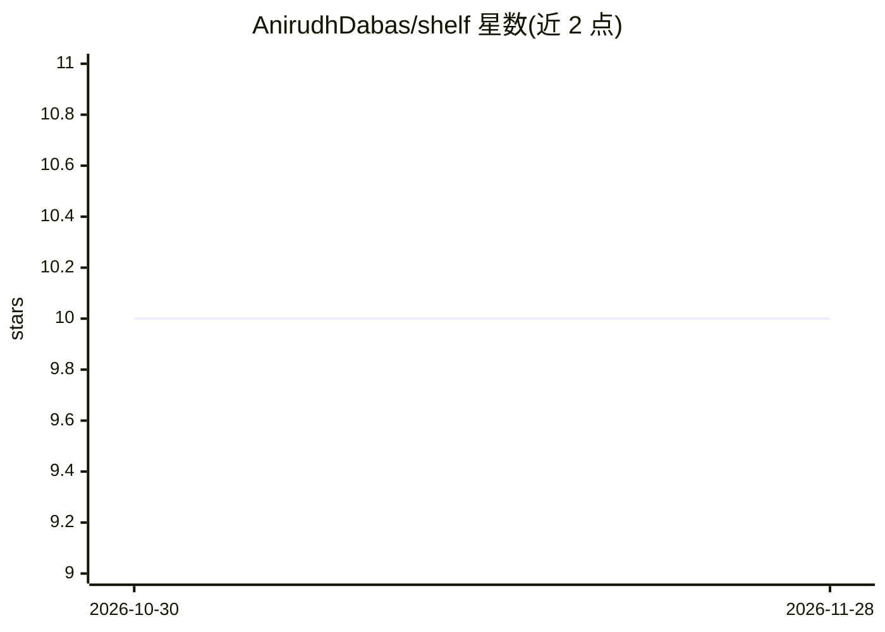

# AnirudhDabas/shelf

⭐ 10 · TypeScript · MIT · 推送 2026-07-01 · [GitHub](https://github.com/AnirudhDabas/shelf) · 个人维护

**为 Shopify 店铺自动优化商品目录以进入 AI 搜索引用**

一个 CLI 形式的自主优化 Agent：用 Claude 为商品目录生成约 50 条模拟购物查询，在 ChatGPT、Perplexity、Claude 网页搜索引用中测量店铺出现率（AI Shelf Score，0-100，每对查询×提供方跑 3 次多数投票去噪），提出标题/描述/metafield/SEO/标签类假设改动，经关键词密度、可读性等回压检查后通过 Shopify Admin GraphQL 应用，按分数升降保留或回滚，全程写入 shelf.jsonl 与 shelf.md。另带 Next.js 仪表盘与 shelf eval 元评估层（假设有效性、分数稳定性、平台期检测、reward hacking 审计）。

## 筛选速览

| 维度 | 判定 | 备注 |
|---|---|---|
| AI 角色 | `ai-native` | 本体是模型或模型工具 |
| 许可风险 | `permissive` | MIT |
| 部署形态 | `library` | 以包/库形式分发 |
| 模型依赖 | locked-api |  |
| 硬件要求 | — | 无带数字的原话,不猜 |
| 安装摩擦 | `low` | 无编译、无系统依赖或容器化 |
| 成熟度 | — | 结构信号不足 |

## 能力要点

- propose→check→apply→measure→keep/revert 的自动闭环实验循环
- AI Shelf Score：AI 引用出现率多数投票测量，结果磁盘缓存
- 7 类假设类型与本地回压检查（关键词密度、Flesch-Kincaid 等）
- shelf eval 元评估：含 reward hacking 风险审计与平台期检测

## 适用场景

- 让 Shopify 商品目录结构更适合被 AI 助手引用
- 持续实验优化商品标题/描述/SEO 并保留有效改动
- 审计自动化优化是否出现标题膨胀等 reward hacking

## 场景标签

 · 领域:电商/AI 搜索优化

## 证据(README 行号)

> L8: `shelf` is an autonomous agent that tunes your product catalog until it does.
> L12: 1. Generate ~50 realistic shopper queries for your catalog with Claude.
> L13: 2. Measure an **AI Shelf Score** — fraction of queries where your store appears in ChatGPT, Perplexity, and Claude'

## 星数曲线

2026-10-30 10 → 2026-11-28 10（+0）

---
*卡片 v1 · prompt 1.4 · 生成 2026-11-20 · 置信度 high · 依据 README sha `071159fd14d0` · [字段定义](../../DATASET.md)*
