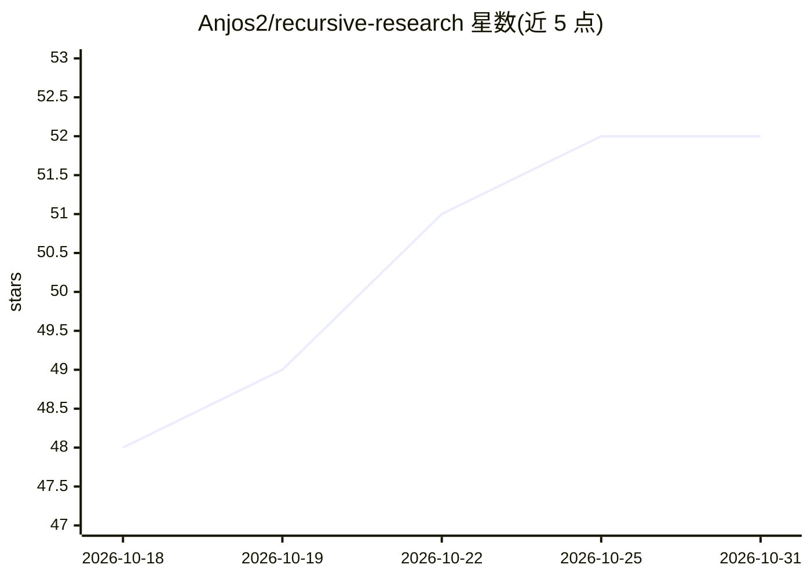

# Anjos2/recursive-research

⭐ 52 · MIT · 推送 2026-04-22 · [GitHub](https://github.com/Anjos2/recursive-research) · 个人维护 · 中文 README

**Claude Code 插件：跨领域递归式深度研究技能**

以 Claude Code 插件/技能形式提供的研究自动化技能：用户提供研究种子后，交互式选择 web/local/mixed 模式，识别 3-5 条种子线索，按自动调节的循环迭代调研；每个来源按透明标准分级为 Tier 1/2/3/拒收，每循环写入磁盘检查点以在上下文压缩后恢复，满足 5 项标准（覆盖率、Tier-1 来源数、新发现饱和度等）或达到循环上限才收尾。决策环节使用加权决策矩阵（WDM）与 Munger 逆向提问。通过 Claude Code 插件市场或手动复制 SKILL.md 安装，所有运行在本地完成。

## 筛选速览

| 维度 | 判定 | 备注 |
|---|---|---|
| AI 角色 | `ai-ecosystem` | LLM/agent 周边工具 |
| 许可风险 | `permissive` | MIT |
| 部署形态 | `None` |  |
| 模型依赖 | — | README 未给出锁定关系 |
| 硬件要求 | — | 无带数字的原话,不猜 |
| 安装摩擦 | `low` | 无编译、无系统依赖或容器化 |
| 成熟度 | — | 结构信号不足 |

## 能力要点

- 来源四级分级（Tier 1/2/3/拒收）并按 tier 记录审计文件
- 每循环磁盘检查点与 --resume 跨会话恢复
- 5 项标准全部满足才声明达到 PhD 水平
- 非平凡决策处应用 WDM + Munger inversion 并展示推理过程

## 适用场景

- 让 Claude Code 对任意学科主题做循环深入的资料调研
- 中断后跨会话恢复研究进度
- 调研结束后获得含来源分级与知识空白的合成报告

## 场景标签

`科研工具` · 领域:学习与行业

## 证据(README 行号)

> L3: > Claude Code **plugin & skill** for recursive research up to PhD level on any topic — science, tech, business, arts
> L33: This repo is a **Claude Code marketplace** containing one plugin (`recursive-research`). The easiest way to install

## 星数曲线

2026-10-18 48 → 2026-10-31 52（+4）

---
*卡片 v1 · prompt 1.4 · 生成 2026-10-24 · 置信度 high · 依据 README sha `656e2173af9e` · [字段定义](../../DATASET.md)*
