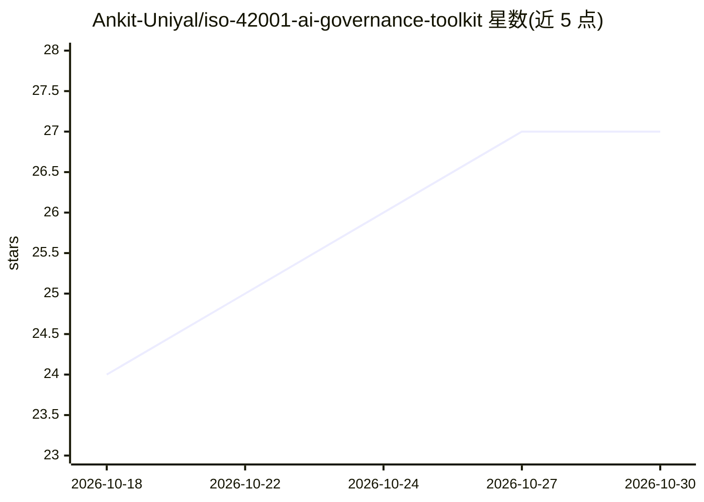

# Ankit-Uniyal/iso-42001-ai-governance-toolkit

⭐ 27 · Python · MIT · 推送 2026-08-02 · [GitHub](https://github.com/Ankit-Uniyal/iso-42001-ai-governance-toolkit) · [官网](https://ankituniyalprofile.com/) · 个人维护

**ISO/IEC 42001 AI 管理体系实施工具包，面向 GRC 从业者**

由 ISO 42001 主任审核师维护的开源文档工具包，覆盖标准全部 10 个条款与 38 项 Annex A 控制措施（9 个域），提供差距评估清单（124 项要求）、12 个月分阶段实施路线图、AI 风险登记册、适用性声明（SoA）、AI 伦理框架、供应商评估与合同条款模板，并交叉映射 EU AI Act、NIST AI RMF 与 ISO/IEC 27001。附虚构金融机构 Nexus 的完整示例与两个 Python 自动化脚本（差距评估检查器、SoA 进度跟踪器）。内容以 Markdown 模板组织，无软件安装步骤。

## 筛选速览

| 维度 | 判定 | 备注 |
|---|---|---|
| AI 角色 | `ai-knowledge` | 知识聚合/清单类 |
| 许可风险 | `permissive` | MIT |
| 部署形态 | `None` |  |
| 模型依赖 | — | README 未给出锁定关系 |
| 硬件要求 | — | 无带数字的原话,不猜 |
| 安装摩擦 | `low` | 无编译、无系统依赖或容器化 |
| 成熟度 | — | 结构信号不足 |

## 能力要点

- 覆盖 10 条款与 38 项 Annex A 控制措施的实施与审核指南
- 124 项要求的差距评估清单与 12 个月实施路线图
- 交叉映射 EU AI Act、NIST AI RMF、ISO/IEC 27001
- 含 Python 自动化脚本：AIMS 差距评估检查器与 SoA 跟踪器

## 适用场景

- 组织按 ISO 42001 建立 AI 管理体系并准备认证审核
- 开展 AI 治理差距评估与风险登记
- 对照 EU AI Act 与 NIST AI RMF 做合规映射

## 场景标签

 · 领域:AI 治理/合规

## 证据(README 行号)

> L3: A practical, open-source implementation toolkit for ISO/IEC 42001:2023 — the international standard for AI Managemen
> L5: Built by an **ISO 42001 Lead Auditor**. Covers all 10 clauses, all 38 Annex A controls across 9 domains, every manda
> L145: - All of Clauses 4 to 10 with implementation templates

## 星数曲线

2026-10-18 24 → 2026-10-30 27（+3）

---
*卡片 v1 · prompt 1.4 · 生成 2026-10-26 · 置信度 high · 依据 README sha `1d1039fef8cd` · [字段定义](../../DATASET.md)*
