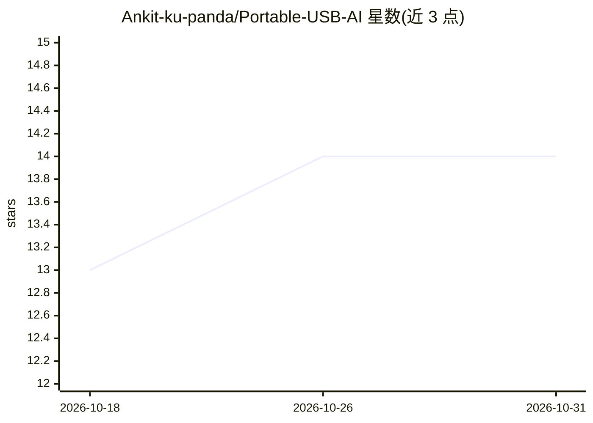

# Ankit-ku-panda/Portable-USB-AI

⭐ 14 · Shell · MIT · 推送 2026-09-26 · [GitHub](https://github.com/Ankit-ku-panda/Portable-USB-AI) · 个人维护

**U 盘便携离线聊天助手：llama.cpp+GGUF 免安装本地对话**

面向普通用户的便携式离线 AI 聊天应用：将 llama-server（llama.cpp）与 Qwen3-4B Q4_K_M GGUF 模型（2.4GB）打包在 U 盘上，通过 Python 标准库后端（127.0.0.1:9000）与 llama.cpp 内置 UI（:8080）双界面共享同一推理进程。双击各平台启动脚本即运行，无需 pip 依赖与联网，聊天记录和配置均存于 U 盘。限制：默认 CPU 模式（约 4-5 tokens/sec），GPU 自动检测未实现，Linux/macOS 需自行添加 llama-server 二进制且未测试。

## 筛选速览

| 维度 | 判定 | 备注 |
|---|---|---|
| AI 角色 | `ai-native` | 本体是模型或模型工具 |
| 许可风险 | `permissive` | MIT |
| 部署形态 | `desktop` | 安装包/桌面程序 |
| 模型依赖 | local-ok | 支持本地模型 |
| 硬件要求 | `cpu-ok` | |
| 安装摩擦 | `medium` | 含编译或系统依赖之一 |
| 成熟度 | — | 结构信号不足 |

## 能力要点

- U 盘跨设备便携：全相对路径，16 项便携性检查通过
- 双 UI 共享单个 llama-server 进程，模型只加载一次
- 100% 离线、仅 localhost、无遥测
- 仅需 Python 3 标准库，无需 pip 包

## 适用场景

- 在任意 Windows 电脑上从 U 盘直接运行私人聊天机器人
- 无网络/需隐私的环境下离线使用本地 LLM 对话
- 通过 OpenAI 兼容 API 在本机调用 GGUF 模型

## 场景标签

`聊天机器人` · 领域:对话与助手

## 证据(README 行号)

> L64: - **Model:** Qwen3-4B-Q4_K_M.gguf (2.4 GB, 4-bit quantized)
> L30: 3. The browser will automatically open to the Llama UI at http://127.0.0.1:8080
> L314: ### ✅ 100% Offline

## 星数曲线

2026-10-18 13 → 2026-10-31 14（+1）

---
*卡片 v1 · prompt 1.4 · 生成 2026-10-31 · 置信度 high · 依据 README sha `13083ff30dd2` · [字段定义](../../DATASET.md)*
