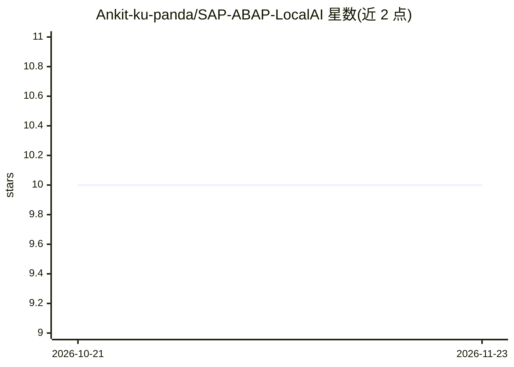

# Ankit-ku-panda/SAP-ABAP-LocalAI

⭐ 10 · Python · MIT · 推送 2026-10-04 · [GitHub](https://github.com/Ankit-ku-panda/SAP-ABAP-LocalAI) · 个人维护

**面向 SAP/ABAP 开发者的本地离线 AI 助手**

为 SAP ABAP 开发者提供的轻量级本地 AI 助手与开发环境，仓库托管脚本、配置与辅助工具，通过 LocalAI 在本地运行模型。功能包括本地模型运行、基于文件的 ABAP 代码片段与文档知识库（放入 knowledge/ 目录后由摄取流程读取并用于生成回答）、Windows 下的 PowerShell 与批处理安装脚本、日志与输出目录用于调试追踪。要求 Windows 10/11 或 Windows Server、Python 3.9+、Git，最低 8 GB 内存；仓库不含模型二进制文件，需自行下载 LocalAI 兼容模型放入 ./models 并在 config.json 配置 model_path。

## 筛选速览

| 维度 | 判定 | 备注 |
|---|---|---|
| AI 角色 | `ai-native` | 本体是模型或模型工具 |
| 许可风险 | `permissive` | MIT |
| 部署形态 | `library` | 以包/库形式分发 |
| 模型依赖 | — | README 未给出锁定关系 |
| 硬件要求 | — | 无带数字的原话,不猜 |
| 安装摩擦 | `low` | 无编译、无系统依赖或容器化 |
| 成熟度 | — | 结构信号不足 |

## 能力要点

- 通过 LocalAI 集成在本地运行模型
- 基于文件的 ABAP 片段与文档知识库，摄取后用于回答生成
- 提供 PowerShell 与三种批处理安装脚本（默认/CPU/均衡配置）
- config.json 可配置端口、模型路径与知识库路径

## 适用场景

- 在本地离线环境向 AI 提问 ABAP 相关问题
- 提供 SAP 模块/类上下文让 AI 起草代码
- 将 ABAP 笔记与文档放入知识库供助手检索引用

## 场景标签

`AI 助手` · 领域:对话与助手

## 证据(README 行号)

> L7: A lightweight local AI assistant and development environment for SAP ABAP developers. This repository hosts scripts,
> L13: - LocalAI integration for running models locally
> L73: - Start the assistant and ask ABAP-related questions using the UI or CLI. The assistant uses the knowledge store pl

## 星数曲线

2026-10-21 10 → 2026-11-23 10（+0）

---
*卡片 v1 · prompt 1.4 · 生成 2026-11-20 · 置信度 mid · 依据 README sha `edf680b7a9dc` · [字段定义](../../DATASET.md)*
