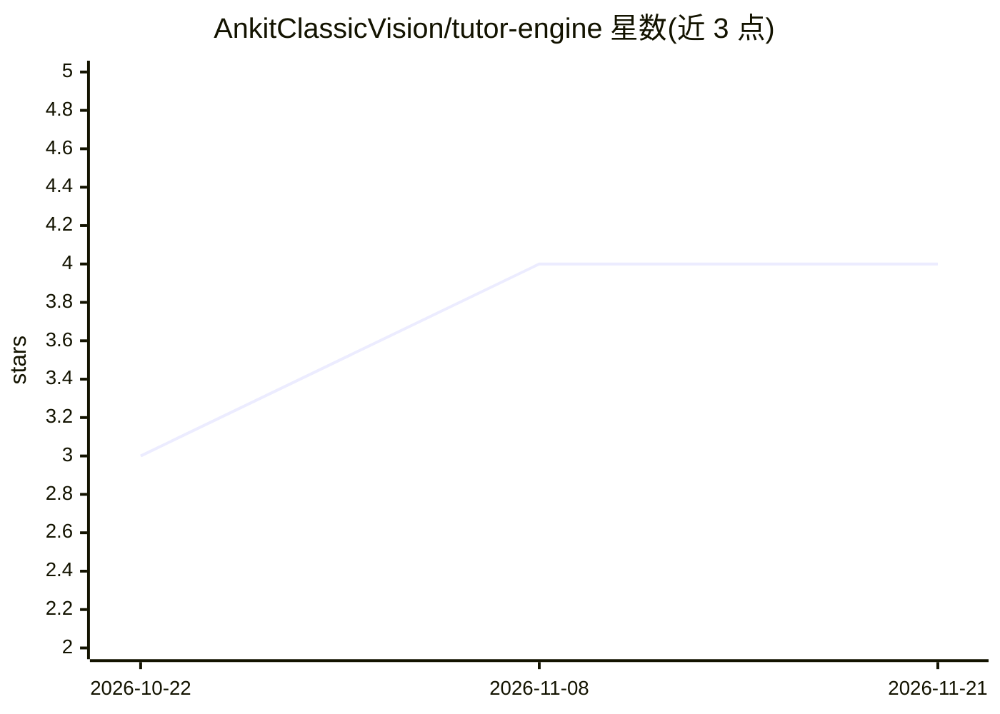

# AnkitClassicVision/tutor-engine

⭐ 4 · TypeScript · AGPL-3.0 · 推送 2026-11-16 · [GitHub](https://github.com/AnkitClassicVision/tutor-engine) · [官网](https://kids-tutor-iota.vercel.app) · 个人维护

**面向 5–14 岁儿童与家长的自适应练习辅导引擎**

将孩子的真实学校生活（课程、作业照片、考试日期、教师评分）转化为 3–25 分钟的短练习任务，仅在独立完成时计为掌握。教学机制包括概念图（遵循 Common Core）、按 Bloom 层级的掌握模型、错误诊断与难度调节；练习、评分与掌握由引擎计算。AI 通过自带密钥（OpenAI/Anthropic/xAI/OpenRouter）用于新学科研究、出题、作业照片读取与批改，每步按 runbook 运行并记录理由；无 AI 时练习任务仍可用。儿童数据按家庭 AES-256-GCM 加密。本地 Node 运行，生产部署为 Vercel + Neon Postgres。

## 筛选速览

| 维度 | 判定 | 备注 |
|---|---|---|
| AI 角色 | `ai-enhanced` | 去掉 AI 部分产品仍成立 |
| 许可风险 | `viral` | AGPL-3.0 |
| 部署形态 | `library` | 以包/库形式分发 |
| 模型依赖 | locked-api |  |
| 硬件要求 | — | 无带数字的原话,不猜 |
| 安装摩擦 | `low` | 无编译、无系统依赖或容器化 |
| 成熟度 | `idea` | |

## 能力要点

- 概念图 + Bloom 掌握模型 + 错误诊断的自适应引擎（src/engine/）
- BYO AI：支持 OpenAI、Anthropic、xAI、OpenRouter，本地可用 ChatGPT Plus/Pro 计划
- 按家庭 AES-256-GCM 加密儿童数据，删除家庭即销毁密钥
- 家长规划器（对话式提议、家长点击后才应用）与每周邮件/PDF 报告

## 适用场景

- 为 5–14 岁孩子生成基于真实作业与考试的短练习任务
- 拍照录入作业题并获得引导帮助与针对性练习
- 家长通过单一界面查看孩子独立完成情况并调整学习计划
- 自托管为家庭私有辅导应用，数据不出本地/自有云

## 场景标签

 · 领域:教育/学习工具

## 证据(README 行号)

> L5: Families bring their own AI (OpenAI, Anthropic, xAI or OpenRouter). Practice missions work with no AI at all.
> L25: **Where the AI is used:** researching new subjects, writing questions and missions, reading homework photos, checki

## 星数曲线

2026-10-22 3 → 2026-11-21 4（+1）

---
*卡片 v1 · prompt 1.4 · 生成 2026-11-21 · 置信度 high · 依据 README sha `744fa092cd62` · [字段定义](../../DATASET.md)*
