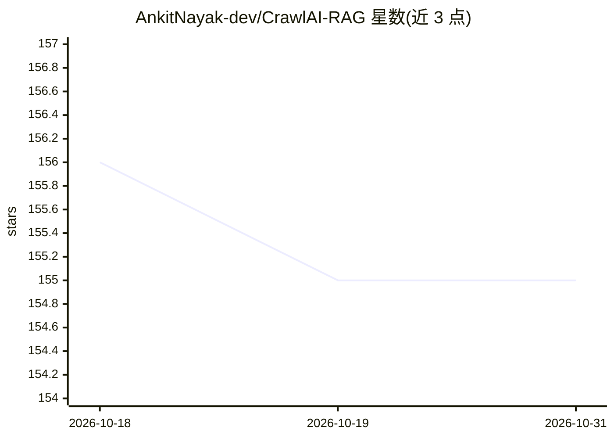

# AnkitNayak-dev/CrawlAI-RAG

⭐ 155 · Python · MIT · 推送 2026-02-15 · [GitHub](https://github.com/AnkitNayak-dev/CrawlAI-RAG) · 个人维护

**把网站爬取并索引成可用自然语言提问的知识库的 RAG 平台**

提供网站爬取、内容索引与 RAG 问答的 Web 应用：后端用 FastAPI，前端用 Streamlit，通过 BeautifulSoup4 与 Playwright 抓取网站内页并提取文本，切分后经 Sentence-Transformers 生成嵌入存入 ChromaDB；提问时检索相关片段，由 Groq 的 LLaMA 3.3 70B 生成基于网站内容的回答。支持多网站共享向量库索引。API key 通过 .env 配置，README 未给出安装命令。

## 筛选速览

| 维度 | 判定 | 备注 |
|---|---|---|
| AI 角色 | `ai-native` | 本体是模型或模型工具 |
| 许可风险 | `permissive` | MIT |
| 部署形态 | `None` |  |
| 模型依赖 | locked-api |  |
| 硬件要求 | — | 无带数字的原话,不猜 |
| 安装摩擦 | `low` | 无编译、无系统依赖或容器化 |
| 成熟度 | — | 结构信号不足 |

## 能力要点

- 爬取网站全部内页并提取可读文本
- 多网站内容存入共享 ChromaDB 向量库
- RAG 问答流程：切块→嵌入→检索→LLM 生成（Groq LLaMA 3.3 70B）
- FastAPI 后端 + Streamlit 单查询界面

## 适用场景

- 对网站文档做自然语言问答
- 把内部站点转成可检索的知识库
- 作为 RAG 应用的演示项目

## 场景标签

`RAG` `文档问答` `网页抓取` · 领域:效率与自动化

## 证据(README 行号)

> L9: **CrawlAI RAG** is an AI-powered website intelligence platform that allows users to **crawl entire websites, index t
> L20: - Uses vector embeddings + LLM
> L74: 5. LLM generates an answer using retrieved context

## 星数曲线

2026-10-18 156 → 2026-10-31 155（-1）

---
*卡片 v1 · prompt 1.4 · 生成 2026-10-22 · 置信度 high · 依据 README sha `c99b1aa75e2a` · [字段定义](../../DATASET.md)*
