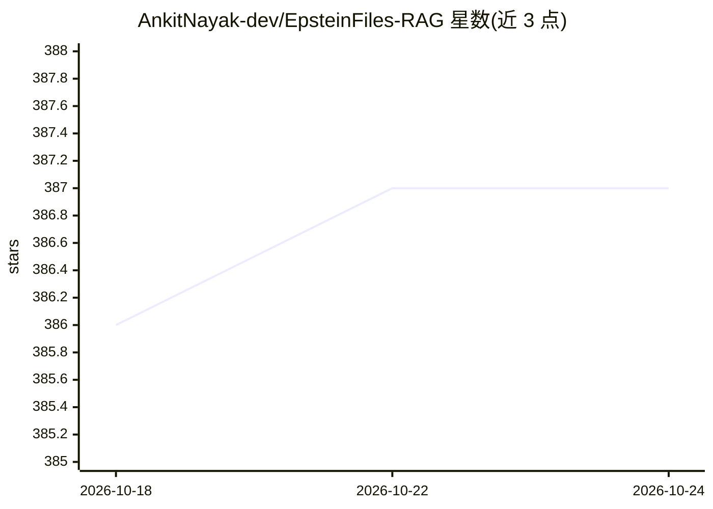

# AnkitNayak-dev/EpsteinFiles-RAG

⭐ 387 · Python · MIT · 推送 2026-02-14 · [GitHub](https://github.com/AnkitNayak-dev/EpsteinFiles-RAG) · 个人维护

**基于 Epstein 文件数据集的 RAG 问答系统：检索文档生成有据回答**

在 Hugging Face 的 Epstein Files 20K 数据集（约 2.5M 行文档）上构建的 RAG 管道：清洗并重建碎片化文档、保上下文的分块、嵌入 Chroma 向量库，用 MMR 算法做多样性检索，经 Groq Cloud 上的 LLaMA 3.3 生成仅基于检索上下文的回答（附来源）。面向开发者与研究人员，提供 FastAPI REST 接口与 Streamlit 界面，需 Python 3.11+、16GB RAM（最低 8GB）与 Groq API key；使用 LangChain 与 Sentence Transformers，声明仅用于研究与教育目的。

## 筛选速览

| 维度 | 判定 | 备注 |
|---|---|---|
| AI 角色 | `ai-native` | 本体是模型或模型工具 |
| 许可风险 | `permissive` | MIT |
| 部署形态 | `library` | 以包/库形式分发 |
| 模型依赖 | locked-api |  |
| 硬件要求 | — | 无带数字的原话,不猜 |
| 安装摩擦 | `low` | 无编译、无系统依赖或容器化 |
| 成熟度 | — | 结构信号不足 |

## 能力要点

- 文档清洗重建 + 保上下文分块 + Chroma 向量库嵌入
- MMR 检索平衡相关性与多样性
- 回答仅基于检索上下文并附来源，端到端约 1 秒
- 提供 FastAPI REST 接口与 Streamlit Web 界面

## 适用场景

- 对公开的 Epstein 文件记录做有据问答
- 研究与教育用途的 RAG 管道参考实现
- 通过 REST API 集成到其他查询系统

## 场景标签

`RAG` `文档问答` · 领域:知识与检索

## 证据(README 行号)

> L2: A RAG pipeline implementation built on the 'Epstein Files 20K' dataset from Hugging Face (Teyler).
> L21: - Generates answers grounded solely in the retrieved context
> L61: Grounded Answer (with sources)

## 星数曲线

2026-10-18 386 → 2026-10-24 387（+1）

---
*卡片 v1 · prompt 1.4 · 生成 2026-10-21 · 置信度 mid · 依据 README sha `0b300eba05dd` · [字段定义](../../DATASET.md)*
