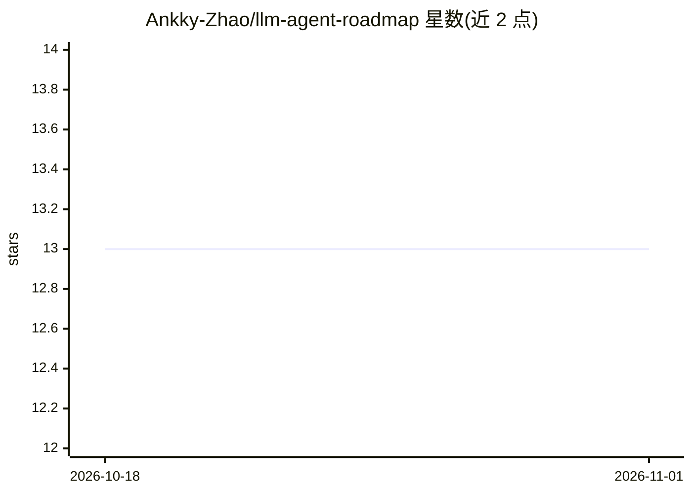

# Ankky-Zhao/llm-agent-roadmap

⭐ 13 · HTML · NOASSERTION · 推送 2026-09-23 · [GitHub](https://github.com/Ankky-Zhao/llm-agent-roadmap) · [官网](https://ankky-zhao.github.io/llm-agent-roadmap/) · 个人维护 · 中文 README

**双语 LLM agent 学习路线图：26 模块、277 条资源与论文时间线**

名为 Agent Atlas 的中英双语学习路线图仓库：以五层结构组织 LLM agent 领域地图，7 个阶段、26 个模块，每模块含概念说明、自检问题、分层资源与动手任务；收录 277 条经链接核验的资源和 99 篇论文时间线（2020-2026）。内容存于 data/ 下 JSON，用 build.py（Python 3.8+，无第三方依赖）生成静态 index.html，支持 GitHub Pages 部署，并配每周链接检查工作流。面向从入门到科研/求职的学习者，进度勾选存于浏览器本地。

## 筛选速览

| 维度 | 判定 | 备注 |
|---|---|---|
| AI 角色 | `ai-knowledge` | 知识聚合/清单类 |
| 许可风险 | `none` | NOASSERTION |
| 部署形态 | `None` |  |
| 模型依赖 | — | README 未给出锁定关系 |
| 硬件要求 | — | 无带数字的原话,不猜 |
| 安装摩擦 | `low` | 无编译、无系统依赖或容器化 |
| 成熟度 | — | 结构信号不足 |

## 能力要点

- 7 阶段 26 模块的中英双语学习路径
- 277 条经逐一访问核验的资源，约 150 小时必读核心路径
- 99 篇关键论文时间线（2020-2026）及项目阶梯
- 每周自动链接检查与社区贡献流程

## 适用场景

- 系统学习 LLM agent 从工具调用到前沿研究
- 按求职或科研方向筛选论文与项目
- 维护一份可勾选进度的 agent 知识地图

## 场景标签

`精选清单` `教程课程` · 领域:学习与行业

## 证据(README 行号)

> L3: **中文 | English** · A bilingual, community-maintainable roadmap for learning LLM agents, from the first tool-calling 
> L11: - **277 条经核验的资源** · 官方文档、课程、视频、博客、论文、代码、书。每条链接在 2026-09-15 逐一访问确认可达。标「必读」的约 150 小时构成核心路径。

## 星数曲线

2026-10-18 13 → 2026-11-01 13（+0）

---
*卡片 v1 · prompt 1.4 · 生成 2026-10-31 · 置信度 high · 依据 README sha `eba1c293d613` · [字段定义](../../DATASET.md)*
