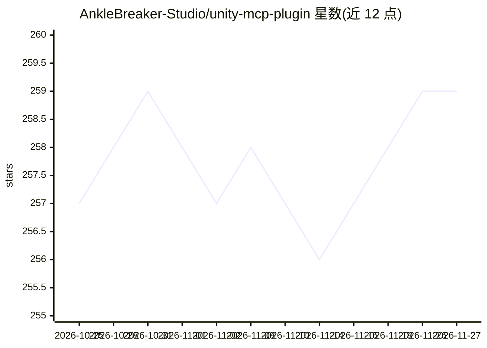

# AnkleBreaker-Studio/unity-mcp-plugin

⭐ 259 · C# · NOASSERTION · 推送 2026-11-21 · [GitHub](https://github.com/AnkleBreaker-Studio/unity-mcp-plugin) · [官网](https://github.com/AnkleBreaker-Studio/unity-mcp-server) · 组织维护

**让 Claude/Cursor 等 MCP 客户端操控 Unity Editor 的 UPM 插件**

UPM 格式的 Unity 编辑器桥接插件，与配套的 Node MCP 服务器配合，使 MCP 兼容客户端可对 Unity 编辑器执行场景编辑、GameObject/组件操作、构建、性能分析、导航网格等操作。核心机制：本地 HTTP 桥（默认端口 7890）、按 agent 的 FIFO 队列与公平调度、票据式请求与已登记操作的命名撤销、每编辑器独立监听与项目身份。限制：桥仅绑定 loopback、需在同机运行配套服务器；重操作仍占用主线程；可选集成（Shader Graph、UMA 等）需各自包。

## 筛选速览

| 维度 | 判定 | 备注 |
|---|---|---|
| AI 角色 | `ai-ecosystem` | LLM/agent 周边工具 |
| 许可风险 | `none` | NOASSERTION |
| 部署形态 | `desktop` | 安装包/桌面程序 |
| 模型依赖 | — | README 未给出锁定关系 |
| 硬件要求 | — | 无带数字的原话,不猜 |
| 安装摩擦 | `low` | 无编译、无系统依赖或容器化 |
| 成熟度 | — | 结构信号不足 |

## 能力要点

- 338 条已注册编辑器路由，覆盖场景、组件、构建、性能分析等类别
- 多 agent 场景：按 agent 的 FIFO 队列、round-robin 调度与分组读取
- MPPM 多人场景控制与 ParrelSync 克隆发现
- Dashboard 显示队列、agent 卡片与 HTTP 活动，支持命名撤销与票据重试

## 适用场景

- 用 Claude 或 Cursor 通过自然语言在 Unity 中搭建原型场景
- 多个 AI agent 并行操作多个独立编辑器项目
- 迭代多人玩法：通过 MCP 配置并启动 MPPM Host/Client
- 让 AI 运行 EditMode 测试并读取编译诊断与控制台输出

## 场景标签

`编码 Agent` · 领域:编码与开发

## 证据(README 行号)

> L8: **The Unity side of a workflow built for multiple projects, multiple agents and multiplayer iteration.** This UPM pa
> L140: 1. The MCP server sends a command with agent identity to the local bridge.
> L53: - The companion Node server and an MCP client are needed for AI-driven operations.

## 星数曲线

2026-10-25 257 → 2026-11-27 259（+2）

---
*卡片 v1 · prompt 1.4 · 生成 2026-11-25 · 置信度 high · 依据 README sha `86bab66dbf6e` · [字段定义](../../DATASET.md)*
