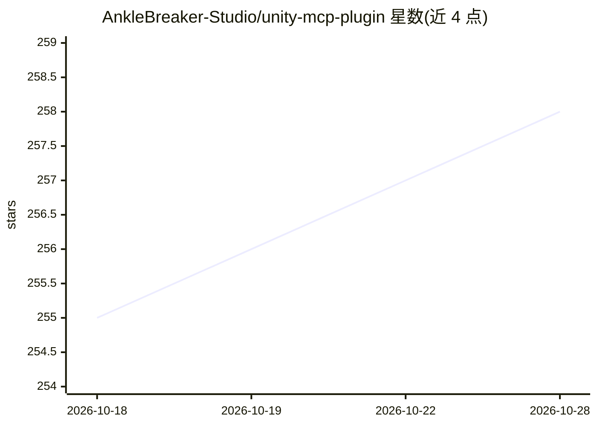

# AnkleBreaker-Studio/unity-mcp-plugin

⭐ 258 · C# · NOASSERTION · 推送 2026-10-23 · [GitHub](https://github.com/AnkleBreaker-Studio/unity-mcp-plugin) · [官网](https://github.com/AnkleBreaker-Studio/unity-mcp-server) · 组织维护

**Unity 编辑器 MCP 桥接插件：让 AI agent 直接操作 Unity Editor**

以 UPM 包形式运行的 Unity Editor 桥接端，与配套 AnkleBreaker Node MCP server 协同，使 Claude、Cursor 等 MCP 兼容 AI 客户端控制 Unity Editor：场景/物体/组件/材质编写、构建、性能分析、测试执行，以及 ProBuilder、Shader Graph、Amplify Shader Editor、MPPM 等可选集成。机制上每编辑器独立监听器与队列，按 agent FIFO 公平调度，命令在主线程执行，支持命名撤销、Dashboard 监控与 HTTP 活动统计。要求 Unity 2021.3.18f1+，需配套 Node server 与 MCP 客户端；重型操作仍占用主线程，撤销不覆盖全部命令。

## 筛选速览

| 维度 | 判定 | 备注 |
|---|---|---|
| AI 角色 | `ai-ecosystem` | LLM/agent 周边工具 |
| 许可风险 | `none` | NOASSERTION |
| 部署形态 | `desktop` | 安装包/桌面程序 |
| 模型依赖 | — | README 未给出锁定关系 |
| 硬件要求 | — | 无带数字的原话,不猜 |
| 安装摩擦 | `low` | 无编译、无系统依赖或容器化 |
| 成熟度 | — | 结构信号不足 |

## 能力要点

- 338 个注册编辑器路由，覆盖场景、组件、构建、profiling 等操作
- 多 agent 公平调度：每 agent FIFO 队列、轮转调度、分组读
- 多编辑器项目独立监听与身份，支持 MPPM 多人场景与 ParrelSync 克隆发现
- Dashboard 监控队列、agent 归因、HTTP 活动与代码执行缓存

## 适用场景

- 让 AI 编程助手在 Unity 中编写场景、材质与玩法脚本并迭代原型
- 多 agent 共享同一 Unity 编辑器时公平排队与隔离项目
- 多人游戏中通过 AI 控制 MPPM Host/Client 场景进行调试

## 场景标签

`编码 Agent` · 领域:编码与开发

## 证据(README 行号)

> L8: **The Unity side of a workflow built for multiple projects, multiple agents and multiplayer iteration.** This UPM pa
> L140: 1. The MCP server sends a command with agent identity to the local bridge.

## 星数曲线

2026-10-18 255 → 2026-10-28 258（+3）

---
*卡片 v1 · prompt 1.4 · 生成 2026-10-22 · 置信度 high · 依据 README sha `41ae2862820e` · [字段定义](../../DATASET.md)*
