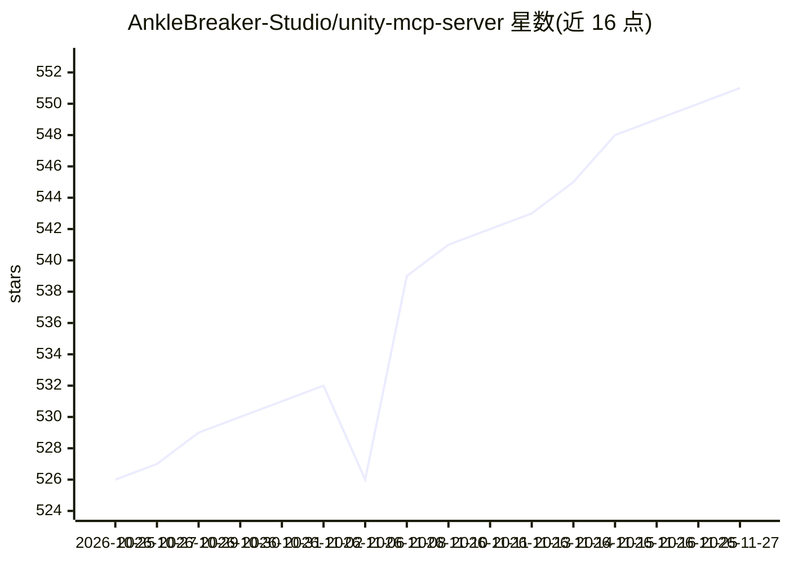

# AnkleBreaker-Studio/unity-mcp-server

⭐ 551 · JavaScript · NOASSERTION · 推送 2026-10-23 · [GitHub](https://github.com/AnkleBreaker-Studio/unity-mcp-server) · [官网](https://anklebreaker-studio.com) · 组织维护

**通过 MCP 将 AI 助手接入 Unity 编辑器与 Hub 的服务器**

AnkleBreaker Studio 开发的 MCP 服务器，配合 Unity 插件把 AI 助手（Claude、Cursor 等 MCP 客户端）连接到 Unity 编辑器与 Unity Hub，提供场景编辑、GameObject/组件操作、构建、性能分析、Shader Graph、地形、物理、NavMesh、动画与 MPPM 多人工具等能力，共 347 个命名操作、80 个默认暴露的 MCP 工具、269 个按需发现的进阶工具。支持多项目与多 agent 的独立路由与队列、操作历史与命名撤销。安装需在 Unity 中以 git URL 添加插件，服务器从源码以 Node.js 18+ 运行。

## 筛选速览

| 维度 | 判定 | 备注 |
|---|---|---|
| AI 角色 | `ai-ecosystem` | LLM/agent 周边工具 |
| 许可风险 | `none` | NOASSERTION |
| 部署形态 | `None` |  |
| 模型依赖 | — | README 未给出锁定关系 |
| 硬件要求 | — | 无带数字的原话,不猜 |
| 安装摩擦 | `low` | 无编译、无系统依赖或容器化 |
| 成熟度 | — | 结构信号不足 |

## 能力要点

- 347 个命名操作：80 个默认暴露工具 + 269 个按需发现的进阶工具
- 多项目/多 agent 支持：独立路由、每编辑器独立队列、agent 身份分离
- 操作历史、命名撤销、队列计时与命令错误的可检查记录
- 覆盖场景、构建、profiling、Shader Graph、MPPM 多人与 ParrelSync

## 适用场景

- 让 AI 助手在 Unity 中构建和迭代游戏场景原型
- 多编辑器/多项目并行开发时为每个 agent 保持独立的项目与队列
- 多人迭代中检查 MPPM Host/Client 场景与虚拟玩家配置
- 通过 AI 运行 EditMode 测试并分页获取失败详情

## 场景标签

`编码 Agent` · 领域:编码与开发

## 证据(README 行号)

> L8: **Build worlds. Coordinate agents. See every action.** Connect your AI assistants to scene authoring, running games,
> L44: **Install from source:** the commands below install `main` in both repositories, including the improvements documen
> L58: Use Node.js 18 or newer; a maintained Node.js LTS is recommended.

## 星数曲线

2026-10-25 526 → 2026-11-27 551（+25）

---
*卡片 v1 · prompt 1.4 · 生成 2026-11-25 · 置信度 high · 依据 README sha `e684f7a71a6a` · [字段定义](../../DATASET.md)*
