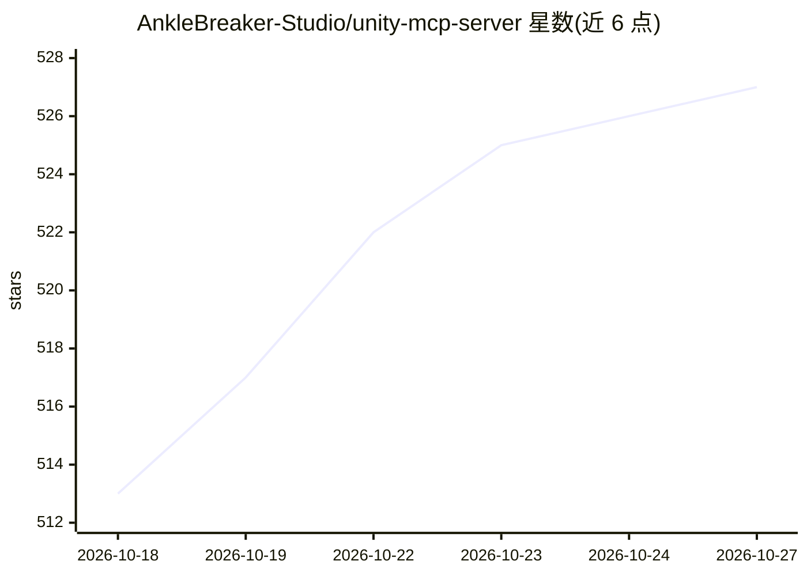

# AnkleBreaker-Studio/unity-mcp-server

⭐ 527 · JavaScript · NOASSERTION · 推送 2026-10-23 · [GitHub](https://github.com/AnkleBreaker-Studio/unity-mcp-server) · [官网](https://anklebreaker-consulting.com/en/projects/unity-mcp) · 组织维护

**连接 AI 助手与 Unity 编辑器的 MCP 服务器（347 项操作）**

面向 Unity 游戏开发的 Model Context Protocol 服务器，由 Unity 插件与 Node.js 服务器组成：将 Claude、Cursor 等 MCP 客户端接入 Unity Editor 与 Unity Hub，提供 347 项命名操作（80 个 MCP 工具默认暴露、269 个高级工具按需发现），覆盖场景编辑、构建、Profiling、Shader Graph、地形、物理、动画、MPPM 多人模式等。关键机制包括多编辑器独立队列与按请求路由、agent 身份归因、可检查的动作历史与命名撤销。要求 Unity 2021.3.18f1+ 与 Node.js 18+，从源码安装。

## 筛选速览

| 维度 | 判定 | 备注 |
|---|---|---|
| AI 角色 | `ai-ecosystem` | LLM/agent 周边工具 |
| 许可风险 | `none` | NOASSERTION |
| 部署形态 | `None` |  |
| 模型依赖 | — | README 未给出锁定关系 |
| 硬件要求 | — | 无带数字的原话,不猜 |
| 安装摩擦 | `low` | 无编译、无系统依赖或容器化 |
| 成熟度 | — | 结构信号不足 |

## 能力要点

- 347 项命名操作：80 个默认 MCP 工具 + 269 个按需发现的高级工具
- 多项目/多 agent 独立请求路由与每编辑器公平队列
- MPPM 多人 Play Mode 场景/玩家控制与 ParrelSync 克隆身份
- agent 动作历史、命名撤销与 Unity Dashboard 可观察性

## 适用场景

- 让 Claude/Cursor 等 AI 助手直接在 Unity 编辑器中搭建场景、迭代玩法
- 多个 Unity 项目并行开发时让不同 agent 各自路由到对应编辑器
- 多人模式下用 AI 助手检查和启动 Host/Client 场景
- 让 AI 助手运行 EditMode/PlayMode 测试并汇报失败结果

## 场景标签

 · 领域:游戏开发/AI 工具链

## 证据(README 行号)

> L8: **Build worlds. Coordinate agents. See every action.** Connect your AI assistants to scene authoring, running games,
> L12: |347 named operations|80 exposed MCP tools|269 advanced tools on demand|
> L32: |**Several projects and agents**|Independent request routing, explicit project selection and a fair queue for each 

## 星数曲线

2026-10-18 513 → 2026-10-27 527（+14）

---
*卡片 v1 · prompt 1.4 · 生成 2026-10-21 · 置信度 high · 依据 README sha `d9e7f5ae1c4d` · [字段定义](../../DATASET.md)*
