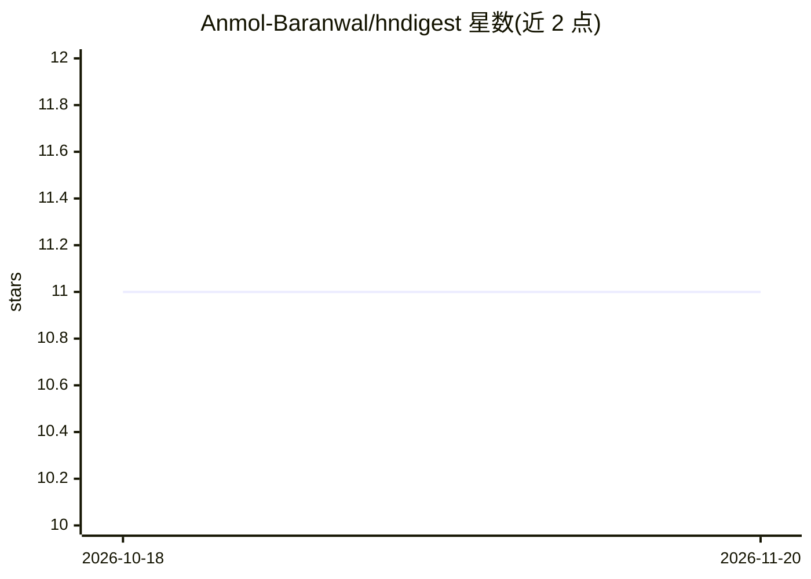

# Anmol-Baranwal/hndigest

⭐ 11 · TypeScript · MIT · 推送 2026-05-16 · [GitHub](https://github.com/Anmol-Baranwal/hndigest) · [官网](https://hndigest.vercel.app) · 个人维护

**通过 AI 对话生成个人化 Hacker News 邮件摘要并定时发送**

面向 HN 读者的 newsletter 生成应用：用户与 AI 对话选择内容板块（热门故事、Show HN、Ask HN、招聘、关键词检索等 10 类），实时预览真实 HN 数据渲染的摘要，可调整样式与发送周期，通过 magic link 激活订阅。构建与预览免费，仅在激活发送时需要 Resend API key（邮件经用户自己的 key 发出，月度免费额度 3,000 封）。技术栈为 Next.js + CopilotKit + Neon + Upstash QStash，支持本地运行与自托管。

## 筛选速览

| 维度 | 判定 | 备注 |
|---|---|---|
| AI 角色 | `ai-native` | 本体是模型或模型工具 |
| 许可风险 | `permissive` | MIT |
| 部署形态 | `None` |  |
| 模型依赖 | — | README 未给出锁定关系 |
| 硬件要求 | — | 无带数字的原话,不猜 |
| 安装摩擦 | `low` | 无编译、无系统依赖或容器化 |
| 成熟度 | — | 结构信号不足 |

## 能力要点

- 对话式编辑：增删板块、调参数、改主题、设定时计划
- 10 类内容板块，支持 count/时间窗口/最低赞数等过滤
- 每个板块默认 5 条、最多 30 条内容
- 邮件经用户自己的 Resend key 发送，可在其面板监控送达

## 适用场景

- 为自己定制每周 Hacker News 邮件摘要
- 按关键词追踪特定主题（如 LLM/AI）的 HN 讨论
- 订阅 Show HN 与 Who's Hiring 板块获取项目与招聘信息

## 场景标签

`AI 写作` `AI 助手` · 领域:对话与助手

## 证据(README 行号)

> L3: Chat with an AI to build your own Hacker News newsletter. Tell it which sections you want, see your digest update li
> L47: - CopilotKit for the agent chat editor

## 星数曲线

2026-10-18 11 → 2026-11-20 11（+0）

---
*卡片 v1 · prompt 1.4 · 生成 2026-11-19 · 置信度 high · 依据 README sha `1e038a769f7f` · [字段定义](../../DATASET.md)*
