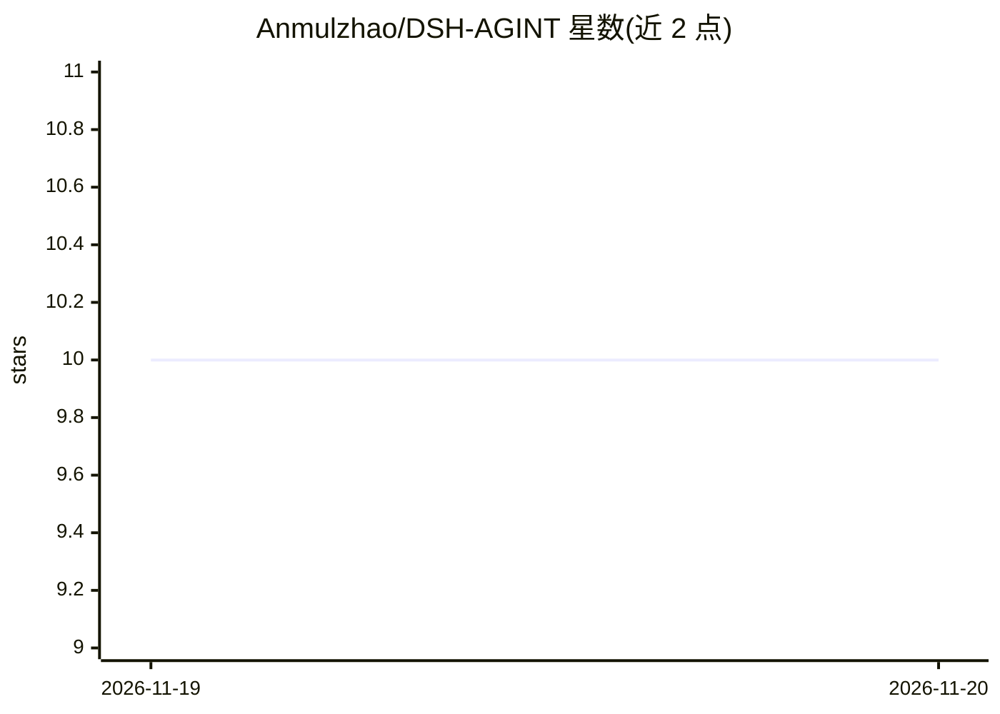

# Anmulzhao/DSH-AGINT

⭐ 10 · JavaScript · MIT · 推送 2026-11-19 · [GitHub](https://github.com/Anmulzhao/DSH-AGINT) · 个人维护 · 中文 README

**基于 DeepSeek Harness 的自进化智能体插件框架**

AGINT 定位为 dsh（DeepSeek Harness）之上的规范与插件集合，明确声明不是 fork 也不是 AGI 实现，提供记忆/反思/约束/度量/评估的工程骨架。结构分 bundle、preset、plugin、data 四层，含 39 个已挂载插件（8 组）、1 套 preset、25 个工具行、10 个 skills、27 个 cron job。新机制须通过 D-QAF 四阶段评估流水线与 HARM 四维指标，自带 kill-switch、降级与审计出口。提供 git clone 安装脚本与 docker 部署路径，装完需重启目标 profile，不热更新。

## 筛选速览

| 维度 | 判定 | 备注 |
|---|---|---|
| AI 角色 | `ai-ecosystem` | LLM/agent 周边工具 |
| 许可风险 | `permissive` | MIT |
| 部署形态 | `library` | 以包/库形式分发 |
| 模型依赖 | locked-api |  |
| 硬件要求 | — | 无带数字的原话,不猜 |
| 安装摩擦 | `low` | 无编译、无系统依赖或容器化 |
| 成熟度 | — | 结构信号不足 |

## 能力要点

- 39 个插件按记忆/调度/反思/质量/闭环/执行/观测/感知 8 组组织
- D-QAF 四阶段评估流水线 + HARM 四维指标 + 进化记忆层
- 新机制自带 kill-switch、降级与审计出口
- 提供 patch 可解析、接线、dsh 兼容、能力边界四步自检脚本

## 适用场景

- 在 dsh runtime 上构建带记忆与反思机制的智能体
- 对智能体进化机制做评估与可审计管理
- 为多 profile（web/desktop）部署统一的智能体插件配置

## 场景标签

`Agent 框架` `Agent 记忆` `模型评测` · 领域:Agent 开发

## 证据(README 行号)

> L7: > 基于 DeepSeek Harness (dsh) 的**自进化智能体框架**。
> L13: - **定位**：dsh 是上游 runtime。AGINT 是它上面的规范与插件集合，不是 fork，也不是 AGI 实现。它提供记忆 / 反思 / 约束 / 度量 / 评估的工程骨架。新功能必须过 D-QAF 评估。
> L20: |**bundle**|`@agint/host`：全部插件 + 挂载 patch|`package.json` + `cordis.patch.yml`|

## 星数曲线

2026-11-19 10 → 2026-11-20 10（+0）

---
*卡片 v1 · prompt 1.4 · 生成 2026-11-20 · 置信度 mid · 依据 README sha `003b61facdce` · [字段定义](../../DATASET.md)*
