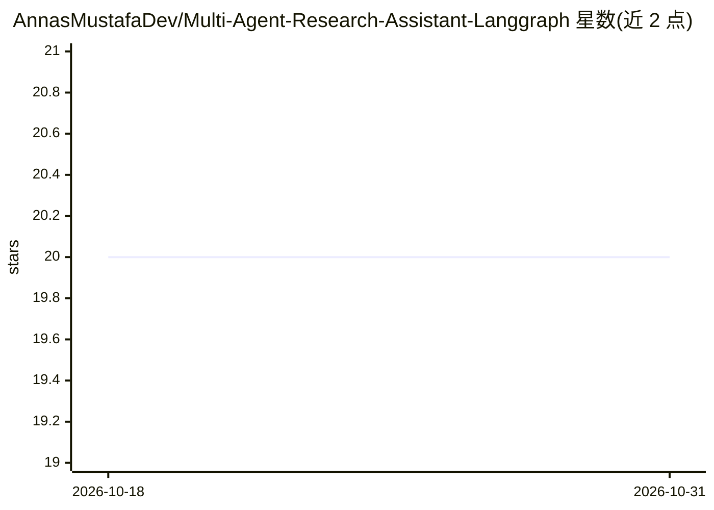

# AnnasMustafaDev/Multi-Agent-Research-Assistant-Langgraph

⭐ 20 · Python · 推送 2025-11-15 · [GitHub](https://github.com/AnnasMustafaDev/Multi-Agent-Research-Assistant-Langgraph) · 个人维护

**LangGraph 多智能体协作系统：自动搜集资料并生成研究报告**

基于 LangChain 与 LangGraph 构建的 A2A 多智能体系统，由 Supervisor、Researcher、Writer、Critiquer 四个专职 agent 协作：Supervisor 协调流程并分派任务，Researcher 通过 Tavily API 检索网络信息，Writer 撰写并修订报告，Critiquer 审稿直至通过。模型调用走 Together AI 的 OpenAI 兼容端点。提供 Streamlit Web 界面，可选 Graphviz 生成工作流图。需配置 Together AI 与 Tavily 两个 API key。

## 筛选速览

| 维度 | 判定 | 备注 |
|---|---|---|
| AI 角色 | `ai-native` | 本体是模型或模型工具 |
| 许可风险 | `none` | — |
| 部署形态 | `library` | 以包/库形式分发 |
| 模型依赖 | locked-api |  |
| 硬件要求 | — | 无带数字的原话,不猜 |
| 安装摩擦 | `low` | 无编译、无系统依赖或容器化 |
| 成熟度 | — | 结构信号不足 |

## 能力要点

- 四个专职 agent 的循环协作工作流（Supervisor/Researcher/Writer/Critiquer）
- Tavily 网络检索 + Together AI OpenAI 兼容端点
- Streamlit Web 界面运行
- 可选 Graphviz 工作流可视化

## 适用场景

- 自动完成资料检索到成稿的研究报告生成
- 体验或学习 LangGraph 多智能体编排模式
- 在此基础上扩展自己的 agent 工作流

## 场景标签

`多智能体` `科研工具` · 领域:Agent 开发

## 证据(README 行号)

> L3: A collaborative **Agent-to-Agent (A2A)** system built using **LangChain** and **LangGraph**, designed to generate de
> L93: The system uses four specialized AI agents that work together:
> L106:  - Creates research reports from findings

## 星数曲线

2026-10-18 20 → 2026-10-31 20（+0）

---
*卡片 v1 · prompt 1.4 · 生成 2026-10-28 · 置信度 high · 依据 README sha `f1f812ac9601` · [字段定义](../../DATASET.md)*
