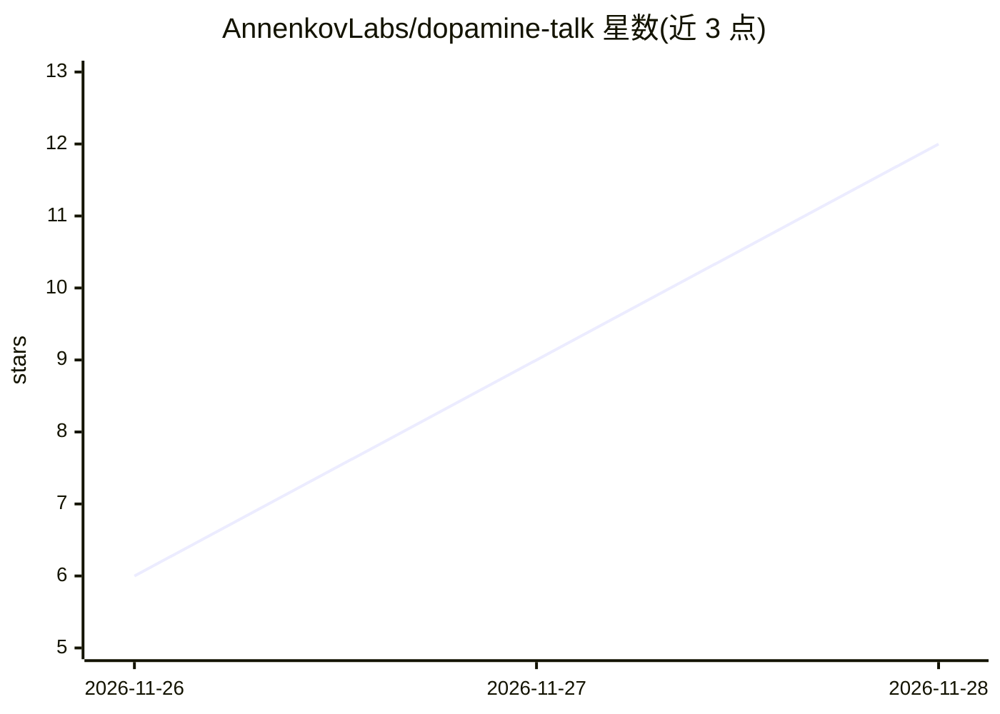

# AnnenkovLabs/dopamine-talk

⭐ 12 · Shell · MIT · 推送 2026-11-26 · [GitHub](https://github.com/AnnenkovLabs/dopamine-talk) · [官网](https://dopamine.annenkov.me) · 个人维护

**给 AI 编码代理去说教腔的 SKILL.md 提示词包**

包含 3 个零依赖的纯 Markdown 技能文件（dopamine-talk、dopamine-readme、dopamine-changelog），分英文与俄文两个原生版本，用于调整编码代理在对话、变更日志与 README 写作中的输出风格：移除说教、对冲免责声明与套话，改写 git diff 为用户影响表述。提供交互式安装向导，自动检测已装代理并以符号链接或复制方式安装；README 声明兼容 20+ 代理，作者说明该风格可能偶有夸断言。

## 筛选速览

| 维度 | 判定 | 备注 |
|---|---|---|
| AI 角色 | `ai-ecosystem` | LLM/agent 周边工具 |
| 许可风险 | `permissive` | MIT |
| 部署形态 | `library` | 以包/库形式分发 |
| 模型依赖 | — | README 未给出锁定关系 |
| 硬件要求 | — | 无带数字的原话,不猜 |
| 安装摩擦 | `low` | 无编译、无系统依赖或容器化 |
| 成熟度 | — | 结构信号不足 |

## 能力要点

- 3 个零依赖纯 Markdown SKILL.md，双语言版本（EN/RU）
- 交互式一键安装向导：选择语言与技能、自动检测代理、symlink 或复制
- changelog 技能要求精确的 Old→New 版本与 CVE/GHSA ID
- README 技能针对 5 秒滚动测试与深/浅色主题做视觉检查

## 适用场景

- 调整编码代理在聊天中的语气与表达结构
- 让 AI 生成的 changelog 聚焦用户影响而非代码叙述
- 用 AI 产出符合视觉规范的 GitHub README

## 场景标签

`提示工程` `代码生成` · 领域:Agent 开发

## 证据(README 行号)

> L9:  Works with 20+ agents
> L103: All three skills are plain Markdown (`SKILL.md`) with zero runtime dependencies. Install the pack once and your ag

## 星数曲线

2026-11-26 6 → 2026-11-28 12（+6）

---
*卡片 v1 · prompt 1.4 · 生成 2026-11-26 · 置信度 mid · 依据 README sha `22d6b48576cd` · [字段定义](../../DATASET.md)*
