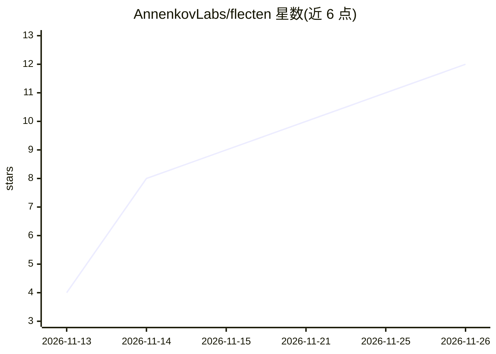

# AnnenkovLabs/flecten

⭐ 12 · TypeScript · AGPL-3.0 · 推送 2026-11-23 · [GitHub](https://github.com/AnnenkovLabs/flecten) · 个人维护 · 中文 README

**编码 Agent 的桌面工作台：对话、文件与 IDE 集于一窗**

基于 Electron + Bun + Svelte 的桌面应用，为编码 Agent 提供统一工作区：Talker 与 Worker 双会话分离（任务运行时可继续对话与转向）、项目记忆跨会话保留、术语词典在调用模型前消解、一键配置 Provider 并自动发现模型、最终回答可渲染为沙箱化交互 HTML。内置 IDE 切换（文件树/编辑器/终端/源码管理）、逐文件 diff 审查与检查点回滚。当前为 Alpha 阶段，需 Bun 1.4+ 从源码运行，默认 Provider 为 openai。

## 筛选速览

| 维度 | 判定 | 备注 |
|---|---|---|
| AI 角色 | `ai-ecosystem` | LLM/agent 周边工具 |
| 许可风险 | `viral` | AGPL-3.0 |
| 部署形态 | `None` |  |
| 模型依赖 | — | README 未给出锁定关系 |
| 硬件要求 | — | 无带数字的原话,不猜 |
| 安装摩擦 | `low` | 无编译、无系统依赖或容器化 |
| 成熟度 | `idea` | |

## 能力要点

- Talker/Worker 双会话：任务运行中可持续对话、中途转向或单独停止 Worker
- 18 个内置工具、4 种 Provider 协议、MCP（stdio/HTTP+OAuth）与 Agent Skills 扩展
- 项目记忆与 Twin 个性化：模型自决保留偏好/决策，条目版本化并按主题组织
- 逐文件可审查 diff、shadow git 检查点与 /undo /redo

## 适用场景

- 在一个窗口内与编码 Agent 协作并随时插话调整任务方向
- 长任务跨会话保留项目偏好、术语定义与历史决策
- 需要审查每次代码修改并支持撤销的 Agent 工作流
- 接入自建/本地模型服务并自动发现可用模型

## 场景标签

`编码 Agent` `AI 助手` · 领域:编码与开发

## 证据(README 行号)

> L5: **The desktop workspace for coding agents.**
> L27: The agent loop is table stakes. Flecten fixes what breaks after the demo.
> L116: The UI never reads files or calls models. It sends commands to a Bun sidecar over a JSONL protocol and receives ty

## 星数曲线

2026-11-13 4 → 2026-11-26 12（+8）

---
*卡片 v1 · prompt 1.4 · 生成 2026-11-20 · 置信度 high · 依据 README sha `7fc326b9936f` · [字段定义](../../DATASET.md)*
