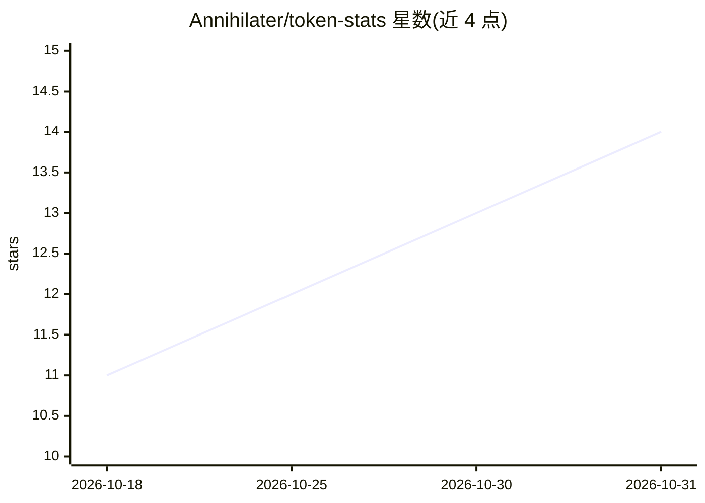

# Annihilater/token-stats

⭐ 14 · Rust · MIT · 推送 2026-07-20 · [GitHub](https://github.com/Annihilater/token-stats) · [官网](https://token-stats.com) · 个人维护 · 中文 README

**追踪多种 AI 编程客户端 token 用量与成本的 CLI 仪表盘**

Rust 核心的命令行工具与 TUI 可视化面板，读取 40 余种 AI 编程客户端（Claude Code、Codex、Cursor、Gemini CLI、OpenCode、OpenClaw、Qwen CLI 等）本地存储的会话数据，聚合展示 token 用量、成本与趋势图。通过 bunx @token-stats/cli 一键运行，预编译原生二进制；实时价格取自 LiteLLM 并带磁盘缓存。支持按模型/客户端/会话多维分组、JSON 导出，以及提交数据到公开排行榜。开发用途需 Node.js/Bun，源码构建另需 Rust 工具链。

## 筛选速览

| 维度 | 判定 | 备注 |
|---|---|---|
| AI 角色 | `ai-ecosystem` | LLM/agent 周边工具 |
| 许可风险 | `permissive` | MIT |
| 部署形态 | `None` |  |
| 模型依赖 | — | README 未给出锁定关系 |
| 硬件要求 | — | 无带数字的原话,不猜 |
| 安装摩擦 | `low` | 无编译、无系统依赖或容器化 |
| 成熟度 | — | 结构信号不足 |

## 能力要点

- 读取 40+ AI 编程客户端本地数据并聚合统计
- Rust 原生核心：并行扫描与 SIMD JSON 解析
- TUI 提供 8 个视图、键盘/鼠标操作与多主题
- LiteLLM 实时定价（1 小时缓存），OpenRouter 兜底

## 适用场景

- 汇总查看我在各家 AI 编程工具上的 token 消耗和花费
- 生成贡献图和每日/每小时用量报表
- 提交用量数据到排行榜并建立公开档案

## 场景标签

`LLM 可观测性` · 领域:评测与运维

## 证据(README 行号)

> L3: > A high-performance CLI tool and visualization dashboard for tracking token usage and costs across multiple AI codi
> L38: **Token Stats** helps you monitor and analyze your token consumption from:
> L106: - **Multi-platform support** - Track usage across OpenCode, Claude Code, Codex CLI, Copilot CLI, Cursor IDE, Gemin

## 星数曲线

2026-10-18 11 → 2026-10-31 14（+3）

---
*卡片 v1 · prompt 1.4 · 生成 2026-10-31 · 置信度 high · 依据 README sha `52942adc5c07` · [字段定义](../../DATASET.md)*
