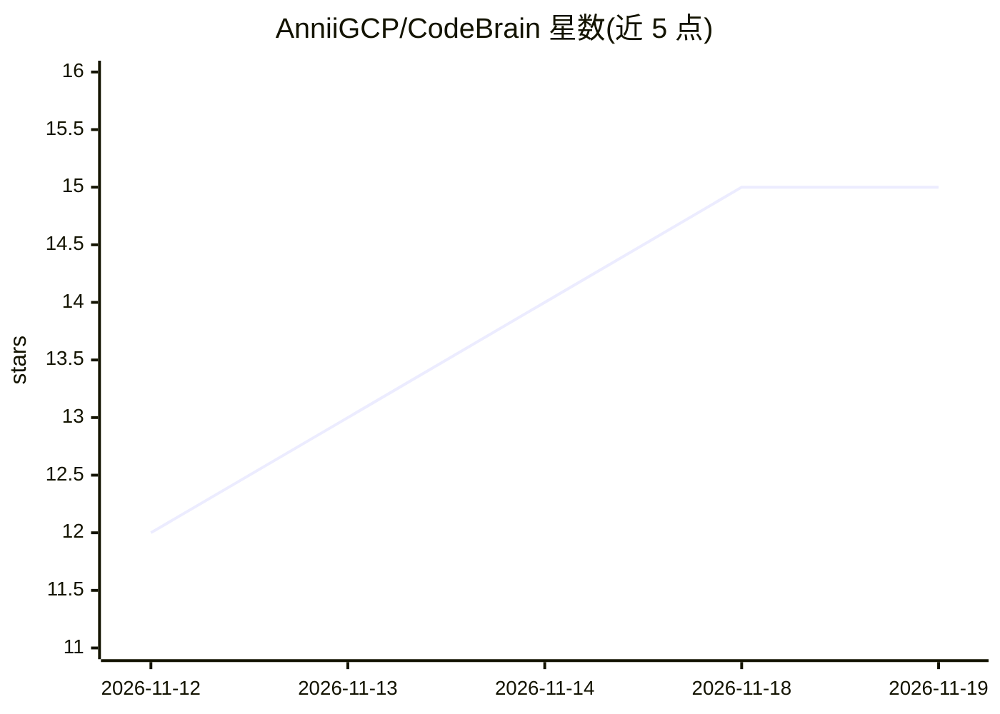

# AnniiGCP/CodeBrain

⭐ 15 · Python · MIT · 推送 2026-11-04 · [GitHub](https://github.com/AnniiGCP/CodeBrain) · [官网](https://codebrain-dev.vercel.app/) · 个人维护

**给开发者的代码库理解与文档生成引擎：AST 分析+RAG 问答+CI/CD 诊断**

面向开发者的软件智能平台：通过 Git 克隆或 ZIP 上传导入仓库，用 Tree-sitter 对 Python/TypeScript/JavaScript/Go/Java 做符号提取与调用图映射；本地 sentence-transformers 嵌入配合 FAISS 检索实现带引用的 RAG 问答；自动生成 16 节企业级技术文档（Markdown/HTML/PDF 导出）；在禁网 Docker 沙箱中验证 AI 生成的补丁；接入 GitHub Actions 失败日志做根因分类与修复 diff 生成。LLM 路由支持 NVIDIA NIM、Groq、Anthropic、APInex 多供应方自动回退。前端 React 19，后端 FastAPI，含 248 个测试。

## 筛选速览

| 维度 | 判定 | 备注 |
|---|---|---|
| AI 角色 | `ai-native` | 本体是模型或模型工具 |
| 许可风险 | `permissive` | MIT |
| 部署形态 | `library` | 以包/库形式分发 |
| 模型依赖 | locked-api |  |
| 硬件要求 | — | 无带数字的原话,不猜 |
| 安装摩擦 | `low` | 无编译、无系统依赖或容器化 |
| 成熟度 | — | 结构信号不足 |

## 能力要点

- Tree-sitter 多语言 AST 符号提取与调用图映射，不执行不可信代码
- 本地 FAISS + MiniLM 嵌入的 RAG 问答，返回带引用的代码片段
- 自动生成 16 节技术文档并导出 Markdown/HTML/PDF
- Docker 沙箱（禁网+cgroup 限制）内验证 AI 补丁后提议 PR
- GitHub Actions 失败日志根因分类与修复 diff 生成

## 适用场景

- 向 AI 提问快速理解陌生的大型代码库结构
- 自动生成本没有文档的遗留项目的技术文档
- 接入 CI 流水线自动分析构建失败原因并给出修复补丁
- 在隔离沙箱中验证 AI 提出的代码修改

## 场景标签

`RAG` `编码 Agent` · 领域:编码与开发

## 证据(README 行号)

> L14: **A high-performance software intelligence platform enabling instant repository ingestion, deep AST symbol analysis
> L40: ### 🧠 Semantic Vector RAG Q&A
> L45: ### 📚 Automated 16-Section Master Technical Documentation

## 星数曲线

2026-11-12 12 → 2026-11-19 15（+3）

---
*卡片 v1 · prompt 1.4 · 生成 2026-11-18 · 置信度 high · 依据 README sha `fa24ced6af25` · [字段定义](../../DATASET.md)*
