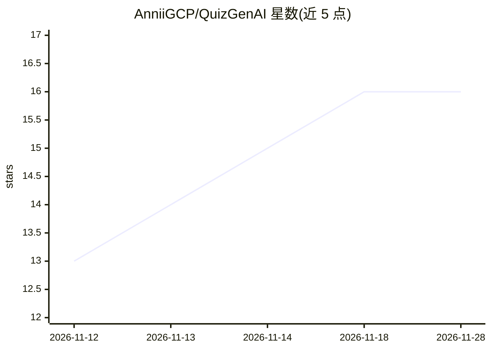

# AnniiGCP/QuizGenAI

⭐ 16 · JavaScript · 推送 2026-11-04 · [GitHub](https://github.com/AnniiGCP/QuizGenAI) · 组织维护

**AI 测验生成与答题平台：从主题或文档生成自适应题目**

FastAPI + React 构建的动态测验平台：用户输入主题关键词或上传文档，由结构化 LLM 提示生成多题测验（含难度曲线），LLM 输出经 Pydantic 合约校验保证题目/选项/答案/解析的固定 JSON schema。前端提供计时答题、即时判分、连击指示、历史成绩与全局排行榜；后端含 Argon2 认证、SQLAlchemy 持久化（PostgreSQL 或默认 SQLite）。LLM 服务支持 NVIDIA NIM / Groq / OpenAI API，本地需 Python 3.10+ 与 Node.js 18+ 分前后端启动。

## 筛选速览

| 维度 | 判定 | 备注 |
|---|---|---|
| AI 角色 | `ai-native` | 本体是模型或模型工具 |
| 许可风险 | `permissive` | — |
| 部署形态 | `library` | 以包/库形式分发 |
| 模型依赖 | — | README 未给出锁定关系 |
| 硬件要求 | — | 无带数字的原话,不猜 |
| 安装摩擦 | `low` | 无编译、无系统依赖或容器化 |
| 成熟度 | — | 结构信号不足 |

## 能力要点

- 从主题关键词或上传文档生成多题测验
- LLM 输出经 Pydantic 合约严格校验为固定 JSON schema
- 前端计时答题、即时判分与连击指示
- 答题记录持久化与全局排行榜

## 适用场景

- 教师或学习者按主题快速生成测验题
- 基于上传文档生成针对性练习题
- 组织带排行榜的在线测验活动

## 场景标签

 · 领域:教育/测验生成

## 证据(README 行号)

> L21: **QuizGenAI** was built during a competitive Hackathon where it secured **🥈 2nd Prize**. The project addresses the 
> L36: - **Topic & Document-Driven Quiz Synthesis:** Generate multi-question assessments from subject keywords or ingested

## 星数曲线

2026-11-12 13 → 2026-11-28 16（+3）

---
*卡片 v1 · prompt 1.4 · 生成 2026-11-18 · 置信度 high · 依据 README sha `acdee7cf1eed` · [字段定义](../../DATASET.md)*
